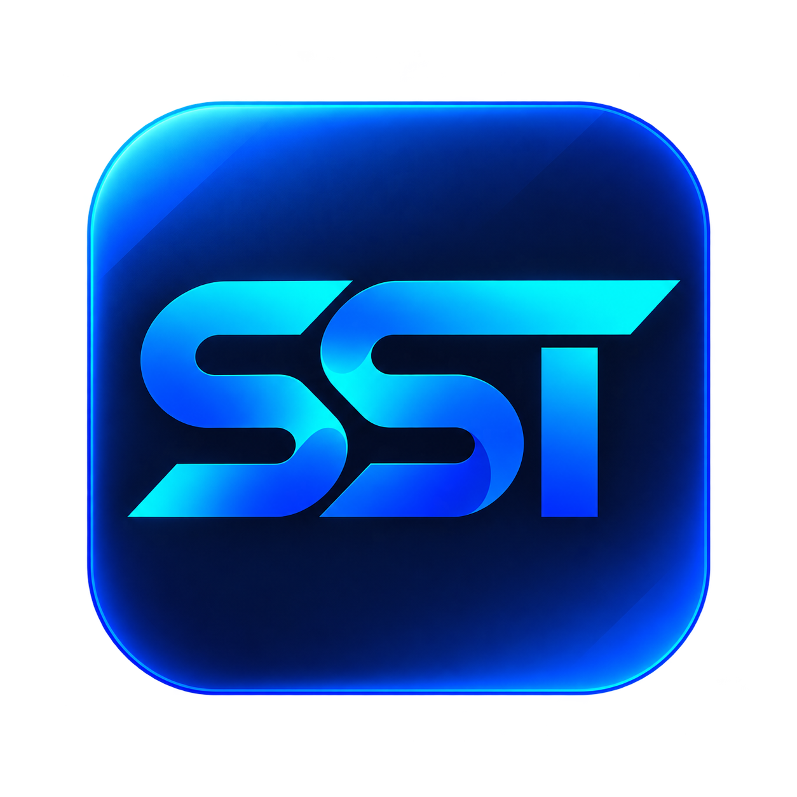

# ssterm — Logo & app icon

**สถานะ:** รับ artwork ที่ผู้ใช้ส่งมาเป็น reference สำหรับ brand/logo/icon ของ ssterm แล้ว; ยังรอ confirm ก่อนนำไป implement หรือสร้าง production exports

ตรวจเปิดไฟล์ใน repo ได้วันที่ 2026-10-14 ปัจจุบัน `docs/logo/icon-logo.png` มีอยู่และอ่านได้ ใช้ path แบบ relative ตามตำแหน่งเอกสารในลิงก์ด้านล่าง

## Artwork inventory

| ไฟล์ | ขนาดจริง | Format | บทบาท |
|---|---|---|---|
| [brand-logo.png](brand-logo.png) | 1448 × 1086 px | PNG RGB; ไม่มี alpha channel | Brand lockup: monogram ลักษณะ SST คู่กับ wordmark `ssterm` บนพื้น navy; reference สำหรับ About/brand presentation |
| [icon-logo.png](icon-logo.png) | 1254 × 1254 px | PNG RGBA; มี alpha channel | แหล่ง artwork ของ app icon: SST monogram บน tile สี่เหลี่ยมมุมมน navy พร้อมขอบ/แสง blue–cyan |
| [design-logo.png](design-logo.png) | 1254 × 1254 px | PNG RGB; ไม่มี alpha channel | ภาพนำเสนอ app icon พร้อมพื้นหลังและแสงเงา; ใช้ดู visual treatment และ proportions |

## Visual identity และการใช้งาน

- ใช้ SST-style monogram ตามภาพที่ให้มาเป็น artwork reference แทนแนว “Connected S” ในบรีฟเดิม คงสัดส่วน ช่องว่าง รูปทรง และ cyan→blue gradient ของต้นฉบับ
- Product name/wordmark ใช้ `ssterm` ตัวพิมพ์เล็กตาม brand lockup; ยังไม่มีข้อมูล font ต้นฉบับของ wordmark จึงไม่อ้างว่าเป็น Inter หรือสร้างตัวอักษรทดแทนจากการคาดเดา
- Application UI ยังคง Signal Blue semantic tokens และ Inter/JetBrains Mono ตาม [design system](../termius/design-system.md) Gradient/lighting ของ logo เป็น brand artwork treatment ไม่เปลี่ยนสี connection status หรือทำให้ทุก control มี glow
- Brand lockup และ design presentation มีพื้นหลังติดมากับ PNG; ใช้ทั้ง composition ตามบทบาท ไม่ถือว่าเป็น transparent logo หรือ glyph ที่แยกพร้อมใช้
- UI glyph/icons สำหรับ buttons/menus เป็นอีกชุดตาม selected shadcn icon library; SST artwork ใช้ระบุตัวตนแบรนด์ ไม่แทน operational icons หรือ healthy/failed state

## Handoff สำหรับ implementation ภายหลัง

1. อ้างอิง source assets ในโฟลเดอร์นี้และบันทึก runtime asset paths หลัง bootstrap ตาม ADR; ไม่เปลี่ยนทับ originals
2. เตรียม derived app-icon exports จาก `icon-logo.png` ที่ 16/32/64/128/256/512/1024 px และ packaging format ที่ macOS/Electron toolchain ต้องใช้ เช่น `.icns`; ปัจจุบันยังไม่มี exports เหล่านี้ใน repo
3. ตรวจ small-size legibility ของ monogram, edge/alpha artifacts, padding/safe area และ rounded tile บนพื้นสว่าง/มืด ก่อนถือเป็น release artwork การมี alpha channel ไม่ได้ยืนยันว่า transparency/edges พร้อม production
4. หากต้องมี small-size/flat/monochrome/vector variant ให้ทำเป็นงานแยกที่อ้างอิงรูปทรงเดิมและผ่าน artwork review; ไม่ถือว่ามี SVG หรือ wordmark-only transparent source แล้ว
5. ตรวจใน packaged Dock/Finder/About UI จริงและบันทึกข้อจำกัดก่อนปิด SST-028/T052 การแนบ reference PNG ในเอกสารยังไม่ใช่ผลผ่าน packaging gate

งานนี้เชื่อมกับ [DS06 — font/icon packaging](../termius/design-system-implementation.md), [SST-028](../termius/tickets.md#sst-028--macos-package--release-readiness) และ [T052](../termius/tasks.md) โดยยังรอ confirm implementation
