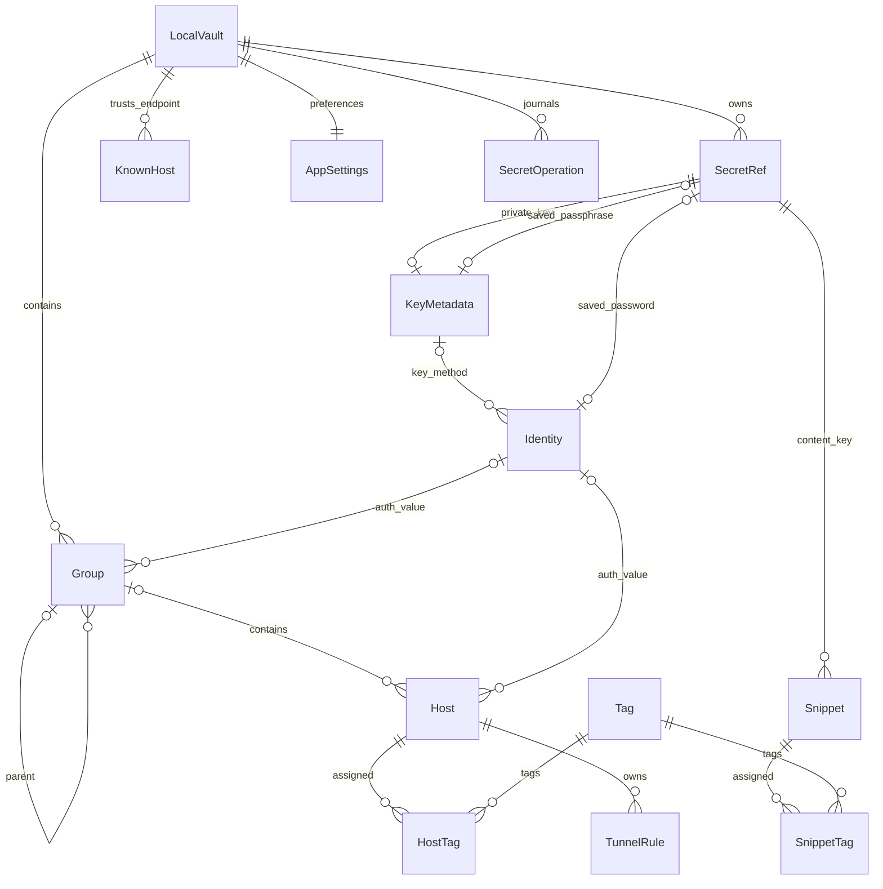

# Domain / privacy / storage specification — SST-003

**Current implementation note — SST-037:** [Team vault](../team-vault.md) has its own private schema1 store, ciphertext snapshots, authority/data high-water, provider/publication journals and permanent virtual-host bindings. It does not add personal catalog hosts or change catalog schema4. Human roles and team credential access are separate from personal sync device capabilities.


**2026-10-15 · Proposed ssterm contracts · `DONE` (specification; independent TEST/REVIEW passed).**
[Authorization / execution plan](../agent-runs/implementation-plan.md#sst-003-execution-plan--2026-10-15): SST-003/T004–T005 only. This document specifies future behavior; it adds no application schema, code, database, encryption implementation or Keychain operation. SST-004 onward remains approval-gated. It describes independent ssterm decisions, not verified Termius behavior.

**Later implementation note:** SST-004 is committed and SST-005 implements the metadata subset under later scoped authorization; see [local storage](../local-storage.md). Protected providers remain SST-006. The original authorization paragraph above records SST-003 scope, not the current execution stop.

## Module and Interface

The Catalog Module owns validated edits, impact previews and effective configuration with provenance. Its Interface accepts a typed change plus expected revisions and returns a committed result, conflict or sanitized failure. The MetadataRepository Seam hides transactions, constraints and migrations; the SecretStore Seam hides OS credential access and reconciliation. Future SQLite and OS-secret Adapters satisfy these Interfaces. React receives catalog views and opaque references; it cannot call arbitrary storage operations. These contracts refine [architecture](proposed-architecture.md), without adding a separate generic CRUD layer for each table.

## Types and common rules

- `Id`: app-generated UUID, immutable, never reused. Every persistent entity belongs to `vaultId: Id`; MVP has exactly one LocalVault. References use `(vaultId, id)` composite foreign keys, preventing cross-vault references even if more vaults are supported later.
- Entity records have `id`, `vaultId`, `revision: integer >= 1`, `createdAt`, `updatedAt` (UTC timestamps). LocalVault uses its `id` as vault identity. Edits increment revision once per committed record change; stale expected revisions reject the entire change. Impact previews capture revisions of every relevant row; changed membership/ancestry invalidates the preview and requires recomputation.
- `label`: trimmed Unicode string, 1–200 characters; labels need not be unique except normalized Tag names. `null` is allowed only where specified; omitted create fields use the documented defaults, omitted edit fields remain unchanged. Empty strings are rejected for required strings; no `null`/empty-string shorthand for inheritance.
- `Port`: integer 1–65535. `EndpointHost`: nonempty DNS name, IPv4 or IPv6 literal, no scheme/path/embedded port/control characters. DNS uses IDNA ASCII lowercase with terminal dot removed; IP literals use canonical textual form and IPv6 is stored without brackets. No DNS resolution, alias merging or case folding of usernames. Invalid/unsupported scoped IP forms are rejected. The shared normalizer must have deterministic fixtures in SST-005/009.
- Ports and auth use explicit unions below. Other text/arrays never implicitly inherit. All multirow catalog edits, constraint checks and revision changes commit in one SQL transaction; OS-secret operations are separate.

```text
PortOverride = { mode: inherit } | { mode: value, port: Port }
AuthOverride = { mode: inherit } | { mode: value, identityId: Id } | { mode: clear }
```

A union stores only its selected payload: inherit/clear cannot carry port/identityId; value requires it. Foreign keys, uniqueness and scalar checks enforce what SQL can express; the Catalog Module validates graph and combination invariants within the same transaction. Future SQLite Adapter enables and verifies foreign-key enforcement on **each connection**; composite parent keys must be declared unique. [SQLite foreign keys](https://www.sqlite.org/foreignkeys.html)

## Persistent field dictionary

Fields below add to the common fields. Defaults are create defaults; `required` means no default. This is a logical dictionary, not a migration or physical SQL schema.

| Record | Typed fields, nullability and defaults | Relations / constraints |
|---|---|---|
| LocalVault | `label: string` required; `contentKeyRef: Id\|null = null`; `protectionFormat: string\|null = null` | contentKeyRef references a published SecretRef of kind content-key; both nullable only before initial protection setup, never cleared while ciphertext exists. Schema version is database-level, described below. |
| Group | `label` required; `parentId: Id\|null = null`; `port: PortOverride = inherit`; `auth: AuthOverride = inherit` | parent references Group in same vault; one parent, no self/cycle; auth value references Identity. Root groups have null parent. |
| Host | `label`, `address: EndpointHost` required; `groupId: Id\|null = null`; `environment: DEV\|STAGING\|PROD\|null = null`; `port = inherit`; `auth = inherit` | group references Group; address is always direct, never inherited. environment is direct display metadata, never an access-control decision. Multiple catalog hosts may address one endpoint. |
| Identity | `label`, `username: string`, `method: password\|key\|keyboard-interactive` required; `passwordRef: Id\|null = null`; `keyId: Id\|null = null` | non-null passwordRef unique; username nonempty, no control characters; one atomic authentication bundle. Exact combinations below; no credentials themselves stored here. |
| KeyMetadata | `label`, `algorithm: string`, `publicKey: string`, `fingerprint: string`, `privateKeyRef: Id` required; `passphraseRef: Id\|null = null` | privateKeyRef kind private-key; passphraseRef kind passphrase; each non-null credential ref unique among owning records. Public fields validated against imported key in SST-006/017. No path back to a user's unowned key file. |
| SecretRef | `kind: password\|private-key\|passphrase\|content-key`; `operationId: Id` required | immutable opaque provider identifier `id`; logical metadata descriptor, not an OS foreign key. Published refs only; unique operationId for create. No secret value or reversible encoding. |
| Tag | `label` required; `normalizedName: string` derived | normalizedName = Unicode NFC + locale-independent lowercase of trimmed label; unique `(vaultId, normalizedName)`. Rename collision rejects; no implicit merge. |
| HostTag / SnippetTag | `vaultId`, `hostId` or `snippetId`, `tagId` required | composite primary key of vault + owner + tag; same-vault foreign keys; no duplicate assignment. Membership edits increment owner revision. No separate id/timestamps/revision. |
| KnownHost | `endpointHost: EndpointHost`, `endpointPort: Port`, `algorithm`, `publicKey`, `fingerprint` required; `firstAcceptedAt`, `lastVerifiedAt: UTC` required | unique `(vaultId, endpointHost, endpointPort)`; one accepted key per endpoint in MVP. Key/fingerprint consistency validated. No Host FK: trust is shared by duplicate catalog entries. |
| Snippet | `label` required; `bodyEnvelope: bytes`, `envelopeVersion: integer >= 1`, `keyRef: Id`, `protectionFormat: string` required | body always authenticated ciphertext, including empty body; keyRef kind content-key. Provider envelope includes its required parameters; no plaintext body/preview/search index column. Tags via SnippetTag. |
| TunnelRule | `label`, `hostId`, `bindPort` required; `type: local\|remote\|dynamic = local`; `bindAddress: 127.0.0.1\|::1\|0.0.0.0\|:: = 127.0.0.1`; `destinationHost`/`destinationPort` required for local/remote, null for dynamic | host FK. MVP (schema 1): local only, loopback only. SST-031 (schema 2): `0.0.0.0`/`::` and `bindPort 0` (server-assigned) only for remote, where the server listens and this Mac opens the destination; dynamic is a loopback SOCKS5 server whose destinations the SSH server opens. Duplicate saved rules allowed; runtime bind collision is explicit failure. Save never starts a tunnel. See [tunnels](../tunnels.md#remote-and-dynamic-socks5-forwarding--sst-031). |
| AppSettings | one row per vault; validated fields below | allowlist only; unknown keys, arbitrary CSS/paths, unsupported enum values and invalid bounds rejected. No credentials, session restore commands or terminal output (the SST-034 recording policy is a separate profile file, `recordings/policy.json`). |
| SecretOperation | `operationId: Id`, `action: create\|replace\|delete`, `state: staged\|reconcile\|cleanup\|complete\|needs-input`, `intendedRef: Id`, `kind: SecretRef.kind`, `oldRef: Id\|null`, `ownerType: vault\|identity\|key\|snippet`, `ownerId: Id`, `expectedRevision: integer\|null`, UTC timestamps required | metadata-only journal; operationId unique and stable across retries; no input/password/body/key bytes. Intended ref may be unpublished/deleted, so is not a live-reference FK. Detailed ordering below. |

Identity combinations are exclusive:

| method | Allowed fields | Effective behavior |
|---|---|---|
| password | keyId null; passwordRef null or password-kind SecretRef | null means transient password prompt, never an empty password/default credential |
| key | keyId required; passwordRef null | KeyMetadata supplies the whole key/passphrase pair; missing passphraseRef prompts only if needed |
| keyboard-interactive | keyId and passwordRef null | transient challenge responses; no saved prompt answers |

No agent/FIDO auth, per-host username merge, ordered fallback list or auth-method fallback is implied. Auth `clear` resolves to no saved identity; connection requires an explicit transient complete identity or configuration decision. Missing/denied secret never silently changes method. Passwords and passphrases may contain empty strings only if explicitly entered as secret input; metadata null is never interpreted as that value.

AppSettings fields (all non-null): `theme: dark = dark`; `uiFont: Inter = Inter`; `uiFontSize: integer 11..20 = 13`; `terminalFont: JetBrains Mono = JetBrains Mono`; `terminalFontSize: integer 10..32 = 13`; `terminalScrollback: integer 100..100000 = 10000`; `terminalPalette: signal-blue-dark = signal-blue-dark`; `terminalCursor: block|bar|underline = block`; `terminalCursorBlink: boolean = false`; `reducedMotion: system|on|off = system`. Fonts refer to packaged families with Thai/system fallback, not user file paths. Terminal preferences remain independent of application tokens. Later settings require a versioned allowlist extension.



The diagram uses [Mermaid ER notation](https://mermaid.js.org/syntax/entityRelationshipDiagram.html#relationship-syntax). Every record, including Tag, Snippet and KeyMetadata, is vault-scoped even where the diagram omits a containment edge. SecretOperation is a reconciliation record, not an ownership FK into the OS store. Session/connection snapshots, prompts, transfer jobs, queues and runtime tunnel state are ephemeral; persist no output, last password, running flag or automatic reconnect queue. Snapshots capture source IDs/revisions, endpoint, effective auth reference, provenance and generation; no persistent secret bytes.

## Resolution and edits

1. Resolve port independently: Host value → nearest Group value walking parents → default **22**. `inherit` continues lookup, including at a root; port has no clear state.
2. Resolve auth as **one atomic Identity selection**: Host value/clear → nearest Group value/clear → default none. `clear` stops traversal; `inherit` continues. Resolve username/method/refs only from the selected Identity revision. Never combine a parent's password with a child's username/key.
3. Return provenance per resolved field (host/group ID + revision or default), plus the selected Identity/KeyMetadata revisions. Tags and environment remain direct assignments; tags filter with AND across selected tags, do not inherit and do not affect auth.
4. Preview group move, override change or Identity edit against every affected descendant host, including hosts inheriting through intermediate groups. A descendant override may cut off an impact. The commit verifies preview revisions and ancestry/membership, checks cycles and commits all selected changes together.
5. New connect/reconnect resolves current records. An authenticated live session retains its captured target/configuration; edits never retarget it or send bytes. A pending operation never substitutes newly selected credentials: deleted/unavailable snapshot refs fail or cancel explicitly. Live secret material is limited to its owned in-memory lifetime; a deleted record cannot be re-resolved. App/OS lock always closes these resources.

## Deletion and impact policy

| Delete | Required result |
|---|---|
| Host | explicit confirmation of owned TunnelRules; delete rules and HostTag memberships in the same transaction; keep KnownHost trust, shared Identity, keys and Tags. Active sessions keep captured target until explicitly closed or locked. |
| Group | preview full subtree/direct and inherited config impacts. Choose move children/hosts to selected parent (or root), or delete entire subtree and its hosts/rules. Move validates no cycles; descendants retain their own overrides, so effective config may change and must be shown. No default hidden cascade. |
| Identity | restrict while Group/Host auth value references remain. Preview direct references **and all effective inherited users**. Choose reassign references to a valid same-vault Identity or detach each direct reference to **clear**, then delete atomically. Detach never means inherit, which could expose an ancestor credential. Children inheriting from those references then resolve clear unless they override. |
| KeyMetadata | restrict while any Identity keyId references it; reassign/delete those identities through their impact flow first. No silent auth conversion. |
| Tag | explicit confirmation; remove only assignments and tag atomically, increment affected owners' revisions; never delete hosts/snippets. |
| Snippet / TunnelRule | delete row and owned memberships; snippet key is vault-shared and retained. Running tunnel must be explicitly stopped through its owner before deleting/editing the running rule. |
| KnownHost | explicit forget/replacement decision for endpoint. Forget makes next connection untrusted; it does not auto-accept or delete catalog hosts. |
| SecretRef / vault key | no direct catalog deletion while live metadata references exist. Queue unreferenced credential cleanup after SQL commit; vault content key cannot be deleted while ciphertext exists. Vault-wide destruction is outside this ticket and requires separate authorization. |

Replacing a secret uses a new immutable ref. Each password/private-key/passphrase ref has one logical owning Identity/KeyMetadata record (enforced by validated ownership/uniqueness); hosts share credentials through that record, never by attaching raw refs to additional owners. The vault content key is intentionally shared by its encrypted snippets. Cleanup checks all live references, pending publications and journal entries before OS deletion; only app-owned namespace refs are eligible. Removing an Identity does not delete a still-shared KeyMetadata; deleting unreferenced key metadata queues its credential refs for cleanup. Tombstones/cloud sync are outside MVP.

KnownHost matching uses the normalized literal endpoint and port, not host label/address DNS result. **Accept once** is ephemeral trust for the current connection generation and never creates a row. **Remember** publishes the accepted key transactionally before proceeding. A mismatch blocks authentication until deliberate replacement; replacement preserves endpoint identity, resets firstAcceptedAt to the new decision time, and records no old secret. Algorithm changes also count as key changes. lastVerifiedAt changes only after a successful key match/accepted decision; existing authenticated sessions are not proof of new trust. SST-009 verifies this shared policy for terminal/SFTP/tunnels.

## Field protection and exposure

| Data | At-rest location | Exposure / lifecycle |
|---|---|---|
| Labels, groups, addresses/ports, usernames/methods, tags, environment, tunnel destinations, public keys/fingerprints, times/revisions, settings and journal metadata | plaintext SQLite metadata | potentially sensitive; local permissions and sanitized errors; no claim of whole-database encryption. Lock does not encrypt these fields. |
| Password, private key, saved passphrase | OS credential store, referenced by opaque immutable SecretRef | transient main-side use only; never persistent React state, SQLite/logs/screenshots/telemetry. Unsaved prompts are not journaled or backed up. |
| Snippet body | mandatory authenticated ciphertext in SQLite | decrypt only while unlocked for explicit editor/Paste/Run action; no plaintext preview/full-text index. Saving/editing never executes; an empty saved body is valid, but Paste/Run returns an empty-snippet outcome without dispatch. Labels/tags can be searched without body decryption. |
| Session log, command history (SST-034, opt-in) | `userData/recordings/{out,cmd}-<uuid>.{part,ssr}` files, never SQLite | STREAM AES-256-GCM segments under a random per-file key wrapped by the vault content key (`recording-key` binding); the key lives only while the recording does; decrypted history cache ≤ 5 min, purged on lock/delete/disable; header (label, endpoint, environment, start time) is metadata-class plaintext. Typed input is never recorded; output is not redacted. [Recording](../recording.md). |
| Recording policy (SST-034) | `userData/recordings/policy.json` (0600) | two switches and retention bounds, not AppSettings; missing or invalid means off. |
| Vault content-protection key | OS credential store, keyRef metadata only | no key export in database backups; never regenerate silently to replace a missing key. |
| Prompt input/decrypted body/decrypted key/cache | transient owned memory | clear UI input after restricted submission; purge on completion, cancellation, timeout, owner disposal, lock or quit. No app-wide credential cache; auth buffers retained only for current auth attempt, decrypted body only for open editor/captured action. |

SST-006 must select and verify a **mature authenticated-protection provider** and versioned envelope with tamper rejection and record/field binding (vault ID, snippet ID and field), plus supported key lifecycle and packaged runtime tests. No custom cryptographic construction, unspecified home-made cipher or plaintext fallback. The provider/algorithm/envelope are not selected or verified here. Credential-store access is a separate contract: Electron [safeStorage](https://www.electronjs.org/docs/latest/api/safe-storage) is an encryption facility, not a credential-store API. ADR candidate [@napi-rs/keyring](https://github.com/Brooooooklyn/keyring-node) remains unverified for this Adapter, including reconciliation lookup support; no Keychain capability claim follows from this spec.

Snippet editors hold transient body state only while unlocked. Paste captures a target and places body in the local pending composer without sending; Run requires explicit ready captured target. Lock cancels both and clears composers/editors, including unsaved body drafts; show that lock discards sensitive drafts before use. Sending bytes never proves command success. No secret-bearing content may appear in diagnostics or validation fixtures committed to the repo.

## Lock, missing keys and backup

App lock or an OS lock event immediately blocks new privileged actions, invalidates all connection/action generations, cancels auth/prompts/transfers/snippet actions, closes terminal/SFTP/tunnel channels/listeners/sockets and purges decrypted caches, composers and editors. SQL transactions complete or roll back before the locked state is reported; newly arriving decrypt/provider results are discarded. OS deletes already in progress may finish; journal reconciliation is deferred until unlock. No surviving SSH channel remains usable while locked. Metadata is retained; physical zeroization in a garbage-collected runtime cannot be guaranteed. SST-006/008/015 must verify actual lock-event support, ordering and resource cleanup.

Unlock is an explicit user action plus successful required provider access, never a promise that macOS prompts on every read. No automatic reconnect, transfer restart, action replay or editor recovery. Provider failures use the typed outcomes below; keep ciphertext/refs intact and offer the corresponding retry/cancel action. OS unlocking alone does not resume app actions.

The SecretStore Interface uses one discriminated outcome vocabulary for reads, ownership lookup and mutations. Read values remain main-side; lookup returns only the owned descriptor, never secret bytes. Only outcomes applicable to an operation are returned.

| Outcome | Meaning | Required caller behavior |
|---|---|---|
| `present` / `confirmed` | read/lookup found the item; mutation completion was confirmed | validate kind/ownership before use or SQL publication; never publish on an unconfirmed write |
| `missing` | provider definitively reports no item | fail affected auth or request re-entry; preserve protected ciphertext. Cleanup may complete idempotently after ownership/reference checks. |
| `locked` | provider explicitly reports locked access | retain state and require explicit unlock/retry or cancel; do not interpret as missing |
| `denied` | access explicitly refused | retain state and offer explicit retry/cancel; no alternate auth or key creation |
| `unavailable` | provider cannot currently be accessed | fail/defer the affected operation with sanitized status; explicit retry/cancel, never a plaintext fallback |
| `unknown` | mutation may have completed or lookup cannot establish its result | keep journal pending; reconcile the same operation/ref before retry, publication or cleanup |
| `error` | definite operation failure with a sanitized stable code | keep existing data and report failure; an ambiguous mutation must be unknown instead |

Adapters preserve the distinctions actually supplied by the OS. If lock cannot be distinguished from access denial or provider unavailability, return the supported category and never fabricate `locked` or `missing`; cancellation is tracked separately by the owning action. SST-006 verifies this mapping, including ambiguous mutation outcomes.

Missing credentials fail only affected auth without fallback. Missing content key or failed authentication of ciphertext preserves the original bytes and refs; mark protected content unavailable/corrupt, prohibit overwrite and do not generate a replacement under the old key identity. First-ever setup creates a key through the journal only when no protected content exists; migrating/creating a separate empty vault is an explicit recovery choice preserving the original vault, outside automatic recovery. Lost original keys without a separately approved recovery mechanism make existing protected bodies unrecoverable.

A backup is an explicit consistent database snapshot after pending mutations are quiescent and the journal is reconciled (unresolved operations block backup). Use the database backup mechanism, including committed WAL content, rather than copy an open database file. It contains metadata/ciphertext/ref descriptors, **no OS secrets or key export**. Record schema/protection versions and checksum beside it without secret values. Restoring must preserve original data and verify integrity/schema/provider refs before use; it cannot execute journal actions against OS secrets until ownership/ref reconciliation succeeds. Restored/rolled-back journal generations are fenced: never automatically replay OS writes/deletes from an old snapshot; explicit recovery validates current ownership/references before any cleanup. Old backups may reference already replaced/deleted secrets, and a consistent SQL snapshot is not a cross-store snapshot. Such a backup is **not portable without the original content key and required credentials**; same machine/account alone does not guarantee key survival. No automatic merge or portable secret export/recovery code in MVP.

## Cross-store journal: ordered, never atomic

SQL transactions do not cover the OS secret store. A metadata-only journal coordinates compensations; it cannot replay an unpersisted password/private key. Adapter capability gate in SST-006: identify/find an item by stable app-owned operationId/intendedRef, return the typed outcomes above, and verify its kind/ownership without exposing value. If the candidate cannot do this reliably, choose an Adapter that can before accepting the implementation; do not assume retry is safe.

1. **Create / replacement stage:** in SQL, persist operationId, immutable intendedRef, kind, owner, expected owner revision and oldRef (replacement). The owning catalog record remains unchanged; new refs are unpublished. Obtain transient input only while unlocked. Never replace an existing provider item in place.
2. **OS write:** create under that stable operationId/intendedRef. A timeout/crash gives an ambiguous result, not permission to generate another ref. Reconcile by provider lookup **before every retry**. Present with matching metadata means do not create again; missing requires input re-entry (or cancel), because the journal has no secret. Denied/unknown remains pending without blind retry. If live input is still available, a confirmed missing item can be retried under the same operation ID.
3. **Publish:** after confirmed write, SQL transaction checks owner/preview revisions, inserts the SecretRef descriptor and publishes the owner/ref (or initializes the vault key). Replacement swaps refs and queues old-ref cleanup in that same transaction. If owner changed/deleted or validation fails, do not publish; queue the confirmed unused new item for cleanup. Snippet encryption and owner publication must finish with the confirmed key; a restart cannot recover an unpersisted plaintext draft.
4. **Delete:** SQL transaction first removes/replaces references and journals cleanup of unreferenced refs; only then request OS deletion. A failed SQL transaction leaves provider items untouched. An OS delete failure leaves cleanup pending and visible through sanitized status, not a falsely successful secret-erasure claim. Successful removal of catalog data can be reported separately from pending secret cleanup. Remove the unreferenced SecretRef descriptor and complete cleanup in SQL only after confirmed OS absence.
5. **Crash reconciliation:** after unlock, inspect unfinished operations before allowing conflicting edits. Stable provider lookup resolves staged/reconcile items: present + valid existing owner revision + reconstructible validated change can publish an intended credential ref swap; absent becomes needs-input/cancel; conflicting owner queues cleanup. If any required owner draft/payload vanished (new Identity/KeyMetadata creation, snippet body or other metadata), cancel publication and clean up the unused new item while preserving existing rows. The journal cannot guess missing fields; only fully recoverable validated intent may publish. A deleted/missing provider item completes cleanup idempotently only after ownership/no-live-ref checks; denied/unknown stays pending. Retain complete metadata until safe compaction; never log values.

Initialization crashes follow the same protocol: an unpublished confirmed content key may publish only to the still-uninitialized vault; ambiguous creation is looked up before retry. Unknown encryption format, operation ownership mismatch or inconsistent journal state fails closed for affected operations; never delete unknown provider items or auto-reset storage. Reconciliation has no exactly-once/cross-store atomicity claim.

## Schema versions and migration / recovery

- SST-005 owns actual migrations/SQL/driver acceptance. One monotonically increasing database `PRAGMA user_version` integer is the authoritative schema version; do not duplicate mutable version columns per entity. New storage starts version 1 after its initial transaction. Envelope/protection version is separate and never inferred from schema version. [SQLite user_version](https://www.sqlite.org/pragma.html#pragma_user_version)
- On open, validate file identity, integrity, supported schema and protection format before writes. Newer schema opens no write path; show compatible-version/recovery options and preserve all files. Corrupt/unreadable storage or failed FK/integrity checks blocks normal catalog use without creating an empty replacement. Diagnose with codes/paths only, no row contents.
- Preflight supported version chain, required space/writability/provider access and absence of unresolved journal work; quiesce writers/actions and take a consistent recoverable pre-migration backup. Each version step applies structural/data changes plus version increment in one transaction; failure rolls that step back and blocks normal use. Earlier successful steps stay committed; never claim whole-chain rollback. Keep original backup for explicit recovery, never overwrite it with the failed attempt.
- Protected data rewrites require the verified provider/key, authenticated decryption and validated re-encryption; no plaintext migration files. Cross-store changes use the journal across resumable phases and cannot be wrapped in a SQL-only atomic migration. Final schema activation waits for reconciliation; failure preserves ciphertext and old readable fields. Unsupported protection formats require a compatible app/provider, never a lossy conversion.
- Recovery works on an explicit copy/backup, preserves original database/WAL and diagnostic identity, and verifies integrity/FKs/version/refs before enabling edits. Read-only inspection is allowed only where safe and supported, not automatic salvage. No silent reset, downgrade, secret regeneration or reuse of IDs from discarded storage.

## Deterministic walkthroughs / future acceptance oracles

Use symbolic IDs below as fixed UUID aliases and lab-only secret values. These are paper walkthroughs, not executed runtime tests.

| Case / initial state → action | Expected result |
|---|---|
| Create vault V; Group G has port=value(2222), auth=value(I1); I1 is password(username=alice, passwordRef=null); create Host H in G at `EXAMPLE.COM.` | normalized `example.com`, revision 1; effective port 2222/provenance G and atomic I1/alice/password-prompt; environment null, no tags. No OS write needed. |
| Edit H port=value(22), auth=clear; G still selects I1 | effective 22 from H and no identity from H; no inherited username/password. Change H to inherit/inherit restores 2222/I1. Null port or clear+identity payload rejects with no revision change. |
| Add child G2 inheriting G; H inherits G2. Edit I1 username alice→bob with valid preview | preview includes H despite indirect inheritance; next connection selects the complete new I1 revision. Ready session remains alice at captured endpoint; no bytes sent by edit. Stale preview fails atomically. |
| Move G2 under root G3 with port=value(2200), auth=value(I2); H inherits | preview shows H 2222/I1→2200/I2; confirm commits new ancestry. Moving G3 below G2 rejects cycle with no row/revision changes. |
| Delete I2 selected by G3; H inherits; root ancestor could select I1 | restrict without impact choice. Confirm detach sets G3 auth=clear and deletes I2 atomically; H resolves none, never I1. Ready H session retains snapshot; reconnect requires a new explicit decision. |
| Delete key K used by I1; delete Host H with saved TunnelRule R | K deletion restricts; I1 unchanged. Host deletion confirms R, removes H/R/HostTags; shared keys/identities/tags and KnownHost row remain. |
| Tag `Prod` exists; create ` prod ` and assign same tag twice to H | normalized-name collision rejects create; duplicate assignment is one membership, no duplicate row. H environment remains independent; invalid environment enum rejects. |
| Remember key A for `EXAMPLE.COM.:22`; second catalog host connects to `example.com:22` with A, then B | same unique trust record; A matches, B blocks before auth. Accept-once at unrecorded port 2222 creates no row; explicit remembered replacement required for changed saved key. |
| Save empty snippet S while unlocked, then edit body | provider-encrypted empty body required; successful edit increments revision, sends no bytes. Provider unavailable/tampered ciphertext rejects access/overwrite, retains old ciphertext; never stores a plaintext fallback. |
| Replace I1 password P1→P2; OS accepts new ref N but app crashes before SQL publish | old owner/ref stays valid. Lookup by same operationId finds N; valid owner revision permits swap + old cleanup transaction. No duplicate OS create. If owner changed, queue N cleanup instead. |
| OS write times out and lookup returns unknown; restart finds missing intended ref | leave pending while unknown; after confirmed missing require re-entry/cancel. Journal cannot reconstruct P2. New operation/ref without resolving the old one is forbidden. |
| Delete last reference to P1; SQL commits cleanup but OS denies delete | catalog removal stays committed, cleanup remains pending with typed denial. Retry checks ownership/live references and uses same operation; missing on later lookup completes cleanup. No cross-store rollback claim. |
| Lock during prompt, transfer and captured snippet Run; late provider result arrives | cancel actions, close all channels/listeners, reject stale generation, clear transient data. Unlock does not reconnect/resend. Original ciphertext/metadata remain. |
| Restore consistent backup on machine missing content key | metadata/ciphertext preserved, protected bodies unavailable; no silent new key. Backup cannot recover lost credentials/key; no journal-driven OS delete before verified restore reconciliation. |
| Migrate v1→v2 transaction fails; alternatively open v3 with app supporting v2, or corrupt DB | failed step remains v1, backup intact; newer/corrupt storage blocks normal writes without reset/downgrade. No application migration/runtime success is asserted by this document. |

## Remaining implementation gates

SST-005 proves SQLite constraints, revision/graph transactions, backup/integrity/migration recovery and deterministic normalization. SST-006 proves OS Adapter namespace/operation lookup, denied/missing/ambiguous outcomes, mature authenticated protection, tamper/record-binding rejection, key/cache/lock lifecycle and packaged dependencies. SST-007/009/017/023 verify domain/trust/edit/protected-body flows through these Interfaces; SST-008/015 verify resource closure and generation invalidation. Tests need project-owned database/Keychain fixtures; no user/Termius/production access. None of these later tickets is authorized or completed by SST-003.

## Implemented workspace-template extension — SST-033

Schema 4 adds `workspace_template` as a versioned metadata entity. It stores a label and exact bounded configuration JSON: saved-host references, globally unique pane slots, tab/split geometry and active/Focus state, plus an optional encrypted-snippet reference. It stores no command body, credentials, terminal history or live session ID. Saves validate referenced catalog items; later deletions leave visible stale references instead of silently substituting another host/snippet. The existing migration backup/transaction path preserves protected content and pending journals. [Behavior and rollback](../workspace-tools.md), [verification](../agent-runs/sst-033-delivery.md).

## Temporary remote-edit content — SST-032

[Remote editing](../remote-edit.md) keeps schema 4 unchanged. Document bytes stay in main-owned private working copies/snapshots and the SFTP stream; IPC carries only bounded metadata, revision and approval identifiers. Explicit external-editor consent shares a plaintext copy with TextEdit, whose independent retention cannot be revoked by app cleanup. Lifecycle cleanup is confined to marked owned directories, with retryable failure accounting and verified orphan handling. Snippet-body authenticated protection remains enforced independently. [Verification and limits](../agent-runs/sst-032-delivery.md).

### Local terminal projection — SST-029

A local generation is transient and has `hostId:null`, no SSH target and main-authored `local:{shell,platform:'darwin'}` metadata. It never calls the saved-host resolver, prompts for SSH credentials or grants SFTP/tunnel capabilities. The single registry still owns local and SSH records/resources, owner/generation fencing, lock/suspend/revoke/quit and native disposal. Start/restart/split never restore commands, process IDs, environment or cwd from metadata. No table, schema migration, local profile, terminal output or shell-history persistence is added (schema 4). See [local terminal](../local-terminal.md) for shell-owned history and child-cleanup limits.

## Recordings — SST-034

Opt-in session logs and command history live outside the catalog in the confined private `userData/recordings/` directory (schema stays 4), so no catalog commit, integrity scan or migration backup ever holds them and Delete removes the only app-controlled copy. One STREAM-encrypted file per terminal generation and kind; per-file keys are wrapped by the vault content key with the v1 envelope and a `recording-key` binding (snippet AAD unchanged). **Lock:** after the registry ends every capture observer, pending key wraps are discarded, the decrypted history cache (one zero-filled buffer, ≤ 5 min) is dropped and plaintext exports in progress abort and remove their stage. **Backup:** recordings are never part of catalog backups; OS backups of the profile and Keychain, unscrubbed SSD blocks and plaintext exports are outside ssterm's control. Retention (age, size, count; never live files) runs at startup, policy change, recording start/end and hourly. See [recording](../recording.md).

## Future sync key boundary — SST-036

[ADR 0006](../adr/0006-sync-cryptography-and-key-lifecycle.md) and the [protocol specification](../sync-crypto.md) define independent sync keys and envelopes, with test-only reference conformance. Schema remains 4; no existing local ciphertext, Keychain ref or journal is migrated. Sync keys need dedicated versioned provider identities and a publication journal in SST-035, rather than being disguised as current `content-key` entries. Local app-lock password/Google/recovery cannot recover these keys. Ordinary sync excludes local secret refs, credentials/private keys, recordings/history and app-lock state; authenticated catalog materialization retains the existing local plaintext-metadata classification. Encrypted sync does not imply whole-database encryption or a portable local backup. Production enrollment, recovery, migration and multi-device behavior remain downstream validation gates.
