# Implementation plan

**SST-011 / T017: `DONE`** — [transient authentication prompts](../auth-prompts.md) ผ่าน independent TEST/REVIEW/DELIVER: unit 157/157, E2E 19/19, packaged 16/16; รวมใน commit SST-011 ตามคำสั่ง “commit”. SST-001–010 committed (`76d473f` latest); SST-012–028 และ DS04–DS06 ยังรออนุมัติ

**สถานะ: `M0_COMPLETE` ณ 2026-10-15.** SST-001 ADR และ SST-002 isolated SSH/SFTP/tunnel compatibility spike ผ่าน pipeline รวม delivery; commit SST-001 (`ad9ed51`) ก่อนเริ่ม SST-002 ตามที่อนุมัติ [Runtime evidence](../spikes/ssh-compatibility.md) ไม่ใช่ production app bootstrap; SST-003/T004–T005 documentation-only `DONE` ตามคำสั่งถัดไป; SST-012–028 ยัง `AWAITING_IMPLEMENT_CONFIRMATION`

## Product baseline / scoped authorization

**MVP M0–M5 / SST-001–028:** macOS arm64 desktop, account-free/local-first, local vault เดียว; hosts/nested groups/tags/inheritance; identities/password/imported keys/keyboard-interactive; trust fingerprints/changed keys; terminal tabs/basic split/Unicode/resize/reconnect; local↔remote SFTP; active-session snippets Paste/Run; local port forwarding; reviewable local package

**UI stack ที่ผู้ใช้เลือกแล้ว:** React + TypeScript บน Electron พร้อม shadcn/ui + Tailwind CSS exact UI versions/build tooling/DS01 อยู่ [ADR 0001](../adr/0001-mvp-platform-stack.md) พร้อม metadata resolution evidence; terminal/SSH/storage/Keychain ยังต้องผ่าน gates ที่ระบุ ไม่อ้าง runtime จาก resolution การอนุมัติ M0 ไม่รวม production bootstrap

**Visual specification:** ใช้ [Design System v1.0 — Signal Blue](design-system.md): dark-first, deep navy + electric blue สำหรับ focus/action, operational status colors แยก, Inter + JetBrains Mono และ terminal-first layout แผนย่อย [DS01–DS06](design-system-implementation.md) อยู่ใน SST-001/004/018/027/028 ผ่าน tasks T047–T052 โดยDS01 เสร็จใน SST-001; DS02–DS03 อยู่ใน SST-004 ที่อนุมัติแล้ว; DS04–DS06 ยังรออนุมัติ; light theme เป็น later proposal

Logo/icon ใช้ supplied SST-style artwork ใน [docs/logo](../logo/README.md) เป็น reference: `brand-logo.png` สำหรับ brand lockup, `icon-logo.png` สำหรับ derived app icons และ `design-logo.png` สำหรับ presentation; exports/alpha-edge QA/macOS packaging อยู่ DS06/T052 ยังไม่เริ่มทำ

**Later SST-029–038:** local PTY/additional OS, host chaining/proxy, remote/dynamic forwarding, advanced SFTP, templates/broadcast/multi-host snippets, logs/autocomplete/AI, own cloud sync/teams/crypto และ Mosh/FIDO แยก scope confirmation เพิ่ม

MVP ใช้ original UI/branding ของ ssterm; published workflow เป็น reference และ proposals อาจต่างจาก Termius เช่น explicit save และ Paste composer; ไม่รับประกัน pixel match, database/API/cloud compatibility หรือ remote process continuity

## Phase sequence / gates

```mermaid
flowchart LR
  C[M0 authorized] --> M0[Decisions + backend spike]
  M0 -. Separate approval required .-> A[M1-M5 scope confirmation]
  A --> M1[Storage + secrets + domain + IPC]
  M1 --> M2[SSH + trust + terminal lifecycle]
  M2 --> M3[Catalog + tabs + split UX]
  M3 --> M4[SFTP + snippets + local tunnels]
  M4 --> M5[Regression + packaged MVP]
  M5 -. Separate scope approval .-> Later[Optional features + own cloud/team]
```

Phase order เป็น milestone view ภายในแต่ละ phase ใช้ dependency graph ใน [tickets](tickets.md) งาน catalog UI, SFTP และ tunnel adapter อาจเริ่มขนานกันเมื่อ foundations พร้อม แต่ acceptance gate ของ milestone ยังต้องครบ

| Milestone | Tickets | Deliverable | Exit gate |
|---|---|---|---|
| M0 | 001–002 | ADR บันทึก UI stack/Signal Blue integration/versions/tooling + backend fixture results | DS01 decisions และ React/Electron/shadcn/ui/Tailwind compatibility/auth/trust/PTY/SFTP/forwarding/package feasibility ผ่าน; blocker มี revised backend/scope decision |
| M1 | 003–007 | Electron + React shell, DS02–DS03 semantic tokens/shared components/showcase, versioned catalog, secrets, resolver, app boundary | token/component state coverage และ restart/migration/secret denial/inheritance/IPC checks ผ่าน |
| M2 | 008–015 | real SSH terminal with prompts/trust/flow control/cleanup | password/key/interactive, changed-key rejection, resize/Unicode, cancel/loss/no leaks ผ่าน |
| M3 | 016–018 | usable catalog/keychain/tabs/splits/preferences + DS04 terminal-first composition | F01–F03, target/PROD/status visibility และ focus/split/session independence เดินครบ |
| M4 | 019–026 | working SFTP/snippets/local tunnels | F04–F06 พร้อม conflicts/cancel/target capture/port collision/teardown ผ่าน |
| M5 | 027–028 | reviewable packaged MVP + DS05 visual/accessibility evidence + DS06 font/icon packaging | E2E/contrast/focus/reduced-motion/performance/package/upgrade matrix ผ่าน; material limitations/artwork status documented |

## Suggested work order

1. M0 ผ่าน delivery โดย commit SST-001 ก่อน SST-002 แล้ว; คำสั่งถัดไปอนุมัติเฉพาะ SST-003 [domain/privacy/storage spec](domain-storage-spec.md) จากนั้น SST-004 สร้าง desktop scaffold/design system/typed IPC ตามคำสั่งล่าสุด; SST-005 เพิ่ม SQLite repository, SST-006 เพิ่ม Keychain/protection และ SST-007 เพิ่ม catalog domain; SST-008 เป็นต้นไปยังรออนุมัติ
2. M1 split งานเป็น Electron/React typed shell/IPC + Signal Blue DS02–DS03 tokens/shared components/showcase, repository/secret adapters และ pure catalog/config rules; schema/protection decisions ต้องพร้อมก่อน persistence code
3. M2 เริ่ม session contract → known-host policy → auth/prompts → real byte-stream/resize → flow control/cleanup ทุกขั้นต้องใช้ fixture จริงประกอบ ไม่มี terminal mock ที่ทำให้ถือว่าเชื่อม SSH ได้แล้ว
4. M3 เติม user flows ที่ผ่าน domain/session contracts; บันทึก UI/behavior deviations อย่างชัดเจน
5. M4 SFTP, snippets และ local tunnels เป็น independent capabilities แต่ reuse trust/auth/resource contracts ผ่าน deps ไม่ต้องเพิ่ม cloud account
6. M5 ทดสอบ packaged artifact จริง ไม่ใช้ dev-mode success แทน package/upgrade/native ABI verification

## Planning estimate

ประมาณก่อน spike สำหรับผู้พัฒนาที่คุ้นเคย desktop/SSH หนึ่งคน; เป็น planning range ไม่ใช่กำหนดส่ง และยังไม่รวม advanced features/cloud/backend/account/mobile

| Phase | Engineering days โดยประมาณ | ความไม่แน่นอนหลัก |
|---|---|---|
| M0 | 4–7 | SSH backend/package capability |
| M1 | 10–17 | secure store/encryption/migration/IPC |
| M2 | 12–20 | prompts/terminal byte flow/lifecycle races |
| M3 | 6–11 | original UX/IME/accessibility/layout |
| M4 | 12–20 | SFTP cancellation/conflicts/tunnel cleanup |
| M5 | 6–10 | clean package/upgrade/regression |
| รวม | 50–85 | reassess หลัง M0 |

หนึ่งคนเต็มเวลาประมาณ 10–17 working weeks ก่อน contingency; กันเพิ่มราว 20% เป็น 12–21 working weeks เพื่อ planning เท่านั้น หลายคนช่วยทำ capabilities/UI ขนานได้ แต่ไม่ได้หารเวลาเป็นสัดส่วนตรงเพราะ dependencies Gates และผล spike ใช้แก้ estimate ก่อน commitment

DS01–DS06 ทำให้รายละเอียด UI/QA/artwork packaging ชัดขึ้น ช่วงเวลาข้างต้นยังเป็น baseline เบื้องต้น ต้องประเมินงาน showcase, contrast adjustments และ production asset preparation จาก supplied artwork ใน M0 ก่อน commitment ไม่ถือว่าการเพิ่ม checklist คือการรับรอง effort เดิม

## Test / acceptance matrix

| Area | Required validation | Tickets |
|---|---|---|
| Catalog/config | parent-child-host overrides, auth bundle, tags AND, cycles, deletion impacts | 003,007,016,017 |
| Storage/secrets | restart/migrate/failure/recovery, fixture Keychain namespace, no secrets in metadata/logs | 005,006,023 |
| App boundary | unauthorized/malformed IPC, session ownership, late-event isolation, URL handling | 004,008,013 |
| Design system | Signal Blue token/component state coverage, blue focus ต่างจาก connection state, target/PROD labels, contrast/reduced motion/resize, offline fonts และ confirmed artwork | 001,004,018,027,028; DS01–DS06 |
| SSH/auth/trust | password/key/encrypted key/interactive prompt, reject/change key, DNS/timeout/denied/cancel | 002,009–011 |
| Terminal | real PTY resize/full-screen/exit, Thai/IME, paste/focus, slow consumer/ordering/memory | 012–014,018 |
| Lifecycle | connect/cancel race, lost network, repeat close/reconnect, app quit/no leaked handles | 008,015 |
| SFTP | browse/unicode/symlink, upload-download hash match, progress/cancel/overwrite/permission/subsystem failure | 019–022 |
| Snippets | save/edit does not run, Paste sends no bytes before submission, Run fixed active target | 023–024 |
| Tunnels | fixture traffic, loopback bind/port collision/start failure/stop/disconnect | 025–026 |
| Package | clean macOS arm64, bundled native dependencies, upgrade/storage/secure-store IDs | 027–028 |

Fixtures ต้องเป็น project-owned local lab data ไม่ใช้ hosts/passwords/Keychain ของ Termius ไม่ต้อง capture private production sessions เพื่อให้ผ่าน acceptance Performance budgets ตั้งจาก M0/014 พร้อม hardware/workload ก่อนใช้เป็น release gate ไม่มี benchmark ผลจริงจากการวิเคราะห์ static นี้

## Risks และแนวทาง resolve

| ความเสี่ยง/unknown | ผลกระทบ | Resolve gate |
|---|---|---|
| Installed artifact integrity mismatch | observations ใช้ได้เฉพาะ observed bytes; publisher equivalence unknown | keep limitations; หากต้อง exact parity ใช้ fresh supplied artifact + signatures ใน separate investigation |
| Main/UI/background semantic coverage partial | อย่าอ้าง complete internal reconstruction | bounded static ledger + own contracts; focused evidence task 038 เมื่อต้องตอบ gap |
| Native SSH/crypto API internals unknown | proprietary adapter reuse/compatibility เสี่ยง | independent library spike 002; cloud crypto review 036 |
| Group/identity/empty/delete contracts ต้องพิสูจน์ใน runtime | UX/data inconsistency | [spec examples 003](domain-storage-spec.md) → domain acceptance 007 ก่อน UI |
| Secret store unavailable/key loss | connect/content access/recovery failures | explicit provider errors/protection matrix 006 |
| SSH prompt/stream/cancel races | wrong-session replies/leaks/hangs | state/generation/ownership 008–015 |
| SFTP partial writes/conflicts | corruption/ambiguous results | policies + real fixtures 021–022 |
| Renderer/dev works but package fails | unusable installed artifact | package viability M0 + clean fixture gate 028 |
| Online docs newer than installed build | published features ไม่ตรง installed runtime | report Published separately; parity tests own fixtures |
| Cloud/team scope grows into MVP | schedule/security complexity | separate later confirmation and crypto/sync/ACL gates |

## Confirmation boundary / stop condition

**2026-10-14 — user confirmation:** อนุมัติ pipeline ANALYZE → DESIGN → PLAN → IMPLEMENT → TEST → REVIEW → DELIVER และ commit **SST-001 ก่อนเริ่ม SST-002** แล้ว delivery + commit SST-002 ขอบเขต **M0 เท่านั้น** รวม DS01/T047 และ isolated fixture/spike/local unsigned arm64 package ใน SST-002 ไม่รวม SST-003–028, DS02–DS06, later tickets, push/external PR/publish/deploy

**2026-10-15 — next-ticket confirmation:** ผู้ใช้สั่ง “ทำงาน ถัดไปต่อได้” หลัง M0 อนุมัติเฉพาะ **SST-003/T004–T005** documentation-only; [domain/storage spec](domain-storage-spec.md) อยู่ `DONE` ผ่าน independent TEST/REVIEW ห้ามเริ่ม SST-004/scaffold/real SQLite/Keychain จากคำสั่งนี้ และไม่มี authorization ใหม่สำหรับ commit/push

Current: SST-001/T001/T047 และ SST-002/T002/T003 `DONE`; [execution record](../agent-runs/implementation-plan.md#sst-003-execution-plan--2026-10-15) บันทึก scope/pipeline ถัดไป และ [backend report](../spikes/ssh-compatibility.md) เก็บ actual M0 runtime evidence

Baseline macOS arm64/local-first/account-free และ product MVP ข้างต้นเป็น scope design ไม่ใช่การอนุมัติ M1–M5 คำสั่งถัดไป supersedes stop condition สำหรับ SST-003 และ SST-004; SST-012–028 และ DS04–DS06 ยังรออนุมัติ; DS02–DS03 ส่งมอบแล้วใน SST-004 ไม่ขออนุมัติซ้ำสำหรับ SST-003 ที่ได้รับอนุมัติแล้ว

**2026-10-15 — earlier SST-004 confirmation:** “commit และทำงานถัดไปต่อ” อนุมัติ commit SST-003 (`603e600`) และ pipeline SST-004/T006/T007/T048/T049; supersedes earlier next-ticket boundary เฉพาะ SST-004 ไม่มี authorization ให้ commit SST-004, push หรือเริ่ม SST-005+ ดู [desktop evidence](../desktop-shell.md)

**Latest SST-005 confirmation:** “commit และเริ่มงานถัดไป” อนุมัติ commit SST-004 (`d6e1822`) และ pipeline SST-005/T008 เท่านั้น; supersedes earlier SST-005 stop. T009/SST-006 และ commit SST-005/push ยังไม่ได้อนุมัติ.

**Latest SST-007 confirmation:** “ทำงานถัดไปได้เลย” authorizes SST-007/T011–T012 after commit SST-006 `9b0ba05`; supersedes the earlier SST-007 stop only. No SST-007 commit/push or SST-008+ scope is inferred.

**Latest SST-008 confirmation:** “commit และเริ่มงานถัดไป” authorizes committing SST-007 (`c124b1b`) then SST-008/T013–T014 lifecycle/ownership through delivery. Does not authorize SST-008 commit/push, SST-009+ or DS04–DS06.

**Latest SST-010 confirmation and delivery:** “ทำ ticket ถัดไปได้เลย” authorized SST-010/T016 only on 2026-10-16; completed through independent TEST/REVIEW/DELIVER. No SST-010 commit/push or SST-011+/DS04–DS06 authorization. See [auth evidence](../ssh-auth.md) and [execution record](../agent-runs/implementation-plan.md#sst-010-execution-plan--2026-10-16).

**Latest SST-011 confirmation and delivery:** “ทำงานถัดไปเลย” after SST-010 `76d473f` authorizes SST-011/T017 only and supersedes older SST-010 stop notes for that ticket. Completed through independent TEST/REVIEW/DELIVER; no SST-011 commit/push or SST-012+/DS04–DS06 authorization. See [prompt evidence](../auth-prompts.md).
