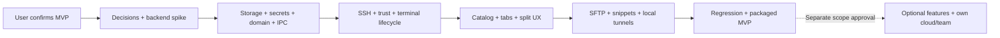

# Implementation plan

**สถานะ: `AWAITING_IMPLEMENT_CONFIRMATION`.** เอกสารนี้จัดทำเพื่อให้ตรวจและยืนยันขอบเขต ยังไม่ได้ bootstrap app, ติดตั้ง application dependencies หรือเขียน feature code

## Scope ที่เสนอให้ยืนยัน

**MVP M0–M5 / SST-001–028:** macOS arm64 desktop, account-free/local-first, local vault เดียว; hosts/nested groups/tags/inheritance; identities/password/imported keys/keyboard-interactive; trust fingerprints/changed keys; terminal tabs/basic split/Unicode/resize/reconnect; local↔remote SFTP; active-session snippets Paste/Run; local port forwarding; reviewable local package

**UI stack ที่ผู้ใช้เลือกแล้ว:** React + TypeScript บน Electron พร้อม shadcn/ui + Tailwind CSS ส่วน terminal renderer, independent SSH adapter, versioned structured storage/OS Keychain และ exact versions/build tooling ยังต้อง validate/pin ใน SST-001–002 การเลือก UI stack เป็นการอัปเดตข้อกำหนด ยังไม่ใช่ confirmation ให้เริ่ม implementation

**Later SST-029–038:** local PTY/additional OS, host chaining/proxy, remote/dynamic forwarding, advanced SFTP, templates/broadcast/multi-host snippets, logs/autocomplete/AI, own cloud sync/teams/crypto และ Mosh/FIDO แยก scope confirmation เพิ่ม

MVP ใช้ original UI/branding ของ ssterm; published workflow เป็น reference และ proposals อาจต่างจาก Termius เช่น explicit save และ Paste composer; ไม่รับประกัน pixel match, database/API/cloud compatibility หรือ remote process continuity

## Phase sequence / gates

Phase order เป็น milestone view ภายในแต่ละ phase ใช้ dependency graph ใน [tickets](tickets.md) งาน catalog UI, SFTP และ tunnel adapter อาจเริ่มขนานกันเมื่อ foundations พร้อม แต่ acceptance gate ของ milestone ยังต้องครบ

| Milestone | Tickets | Deliverable | Exit gate |
|---|---|---|---|
| M0 | 001–002 | ADR บันทึก selected UI stack/versions/tooling + backend fixture results | React/Electron/shadcn/ui/Tailwind compatibility และ auth/trust/PTY/SFTP/forwarding/package feasibility ผ่าน; blocker มี revised backend/scope decision |
| M1 | 003–007 | Electron + React shell, shadcn/ui/Tailwind theme, versioned catalog, protected secrets/content, config resolver, app boundary | restart/migration/secret denial/inheritance/IPC validation tests และ renderer component/theme smoke checks ผ่าน |
| M2 | 008–015 | real SSH terminal with prompts/trust/flow control/cleanup | password/key/interactive, changed-key rejection, resize/Unicode, cancel/loss/no leaks ผ่าน |
| M3 | 016–018 | usable catalog/keychain/tabs/splits/preferences | F01–F03 และ focus/split/session independence เดินครบ |
| M4 | 019–026 | working SFTP/snippets/local tunnels | F04–F06 พร้อม conflicts/cancel/target capture/port collision/teardown ผ่าน |
| M5 | 027–028 | reviewable packaged MVP + evidence of checks | E2E/accessibility/performance/package/upgrade matrix ผ่าน; material limitations documented |

## Suggested work order

1. หลัง confirm ทำ SST-001/002 และ SST-003 spec ก่อนลงลึก UI อย่าให้ฟอร์มสร้าง assumptions ที่ backend/library ทำไม่ได้
2. M1 split งานเป็น Electron/React typed shell/IPC + shadcn/ui/Tailwind shared components/theme, repository/secret adapters และ pure catalog/config rules; schema/protection decisions ต้องพร้อมก่อน persistence code
3. M2 เริ่ม session contract → known-host policy → auth/prompts → real byte-stream/resize → flow control/cleanup ทุกขั้นต้องใช้ fixture จริงประกอบ ไม่มี terminal mock ที่ทำให้ถือว่าเชื่อม SSH ได้แล้ว
4. M3 เติม user flows ที่ผ่าน domain/session contracts; บันทึก UI/behavior deviations อย่างชัดเจน
5. M4 SFTP, snippets และ local tunnels เป็น independent capabilities แต่ reuse trust/auth/resource contracts ผ่าน deps ไม่ต้องเพิ่ม cloud account
6. M5 ทดสอบ packaged artifact จริง ไม่ใช้ dev-mode success แทน package/upgrade/native ABI verification

## Planning estimate

ประมาณก่อน spike สำหรับผู้พัฒนาที่คุ้นเคย desktop/SSH หนึ่งคน; เป็น planning range ไม่ใช่กำหนดส่ง และยังไม่รวม advanced features/cloud/backend/account/mobile

| Phase | Engineering days โดยประมาณ | ความไม่แน่นอนหลัก |
|---|---|---|
| M0 | 4–7 | SSH backend/package capability |
| M1 | 10–17 | secure store/encryption/migration/IPC |
| M2 | 12–20 | prompts/terminal byte flow/lifecycle races |
| M3 | 6–11 | original UX/IME/accessibility/layout |
| M4 | 12–20 | SFTP cancellation/conflicts/tunnel cleanup |
| M5 | 6–10 | clean package/upgrade/regression |
| รวม | 50–85 | reassess หลัง M0 |

หนึ่งคนเต็มเวลาประมาณ 10–17 working weeks ก่อน contingency; กันเพิ่มราว 20% เป็น 12–21 working weeks เพื่อ planning เท่านั้น หลายคนช่วยทำ capabilities/UI ขนานได้ แต่ไม่ได้หารเวลาเป็นสัดส่วนตรงเพราะ dependencies Gates และผล spike ใช้แก้ estimate ก่อน commitment

## Test / acceptance matrix

| Area | Required validation | Tickets |
|---|---|---|
| Catalog/config | parent-child-host overrides, auth bundle, tags AND, cycles, deletion impacts | 003,007,016,017 |
| Storage/secrets | restart/migrate/failure/recovery, fixture Keychain namespace, no secrets in metadata/logs | 005,006,023 |
| App boundary | unauthorized/malformed IPC, session ownership, late-event isolation, URL handling | 004,008,013 |
| SSH/auth/trust | password/key/encrypted key/interactive prompt, reject/change key, DNS/timeout/denied/cancel | 002,009–011 |
| Terminal | real PTY resize/full-screen/exit, Thai/IME, paste/focus, slow consumer/ordering/memory | 012–014,018 |
| Lifecycle | connect/cancel race, lost network, repeat close/reconnect, app quit/no leaked handles | 008,015 |
| SFTP | browse/unicode/symlink, upload-download hash match, progress/cancel/overwrite/permission/subsystem failure | 019–022 |
| Snippets | save/edit does not run, Paste sends no bytes before submission, Run fixed active target | 023–024 |
| Tunnels | fixture traffic, loopback bind/port collision/start failure/stop/disconnect | 025–026 |
| Package | clean macOS arm64, bundled native dependencies, upgrade/storage/secure-store IDs | 027–028 |

Fixtures ต้องเป็น project-owned local lab data ไม่ใช้ hosts/passwords/Keychain ของ Termius ไม่ต้อง capture private production sessions เพื่อให้ผ่าน acceptance Performance budgets ตั้งจาก M0/014 พร้อม hardware/workload ก่อนใช้เป็น release gate ไม่มี benchmark ผลจริงจากการวิเคราะห์ static นี้

## Risks และแนวทาง resolve

| ความเสี่ยง/unknown | ผลกระทบ | Resolve gate |
|---|---|---|
| Installed artifact integrity mismatch | observations ใช้ได้เฉพาะ observed bytes; publisher equivalence unknown | keep limitations; หากต้อง exact parity ใช้ fresh supplied artifact + signatures ใน separate investigation |
| Main/UI/background semantic coverage partial | อย่าอ้าง complete internal reconstruction | bounded static ledger + own contracts; focused evidence task 038 เมื่อต้องตอบ gap |
| Native SSH/crypto API internals unknown | proprietary adapter reuse/compatibility เสี่ยง | independent library spike 002; cloud crypto review 036 |
| Group/identity/empty/delete semantics ยังต้องตัดสิน | UX/data inconsistency | spec examples 003/007 ก่อน persistence/UI |
| Secret store unavailable/key loss | connect/content access/recovery failures | explicit provider errors/protection matrix 006 |
| SSH prompt/stream/cancel races | wrong-session replies/leaks/hangs | state/generation/ownership 008–015 |
| SFTP partial writes/conflicts | corruption/ambiguous results | policies + real fixtures 021–022 |
| Renderer/dev works but package fails | unusable installed artifact | package viability M0 + clean fixture gate 028 |
| Online docs newer than installed build | published features ไม่ตรง installed runtime | report Published separately; parity tests own fixtures |
| Cloud/team scope grows into MVP | schedule/security complexity | separate later confirmation and crypto/sync/ACL gates |

## Confirmation boundary / stop condition

ขณะนี้ stop ที่เอกสาร reviewable เหล่านี้ตามคำขอผู้ใช้ การตอบ confirm MVP จะอนุญาตเริ่ม SST-001–028 รวม spike/build/tests/local packaging; optional later work, deployment/publishing และการแก้ account/config ภายนอกไม่ได้รวมโดยอัตโนมัติ

UI stack ที่เลือกแล้วคือ React + Electron + shadcn/ui + Tailwind CSS ส่วน default scope ที่ยังรอยืนยันคือ macOS arm64 + local-first + account-free + explicit save/Paste semantics + no cloud/team in MVP; backend/versions/tooling ผ่าน ADR/spike ผู้ใช้สามารถแก้ requirement ก่อนเริ่มได้ โดยปรับไฟล์ที่เกี่ยวข้องพร้อมกัน

เมื่อมี confirmation บันทึกข้อความ/scope/date ในส่วนนี้และเปลี่ยน ticket ที่เริ่มจริงเป็น `IN_PROGRESS` ก่อนทำงาน ไม่ทำเครื่องหมาย approved/completed จากการส่งเอกสารหรือเวลาที่ผ่านไป
