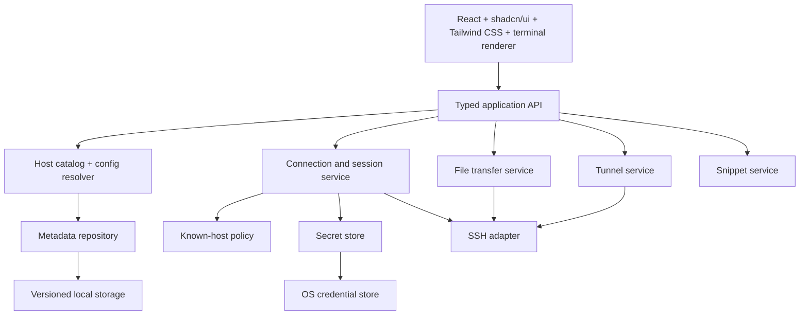
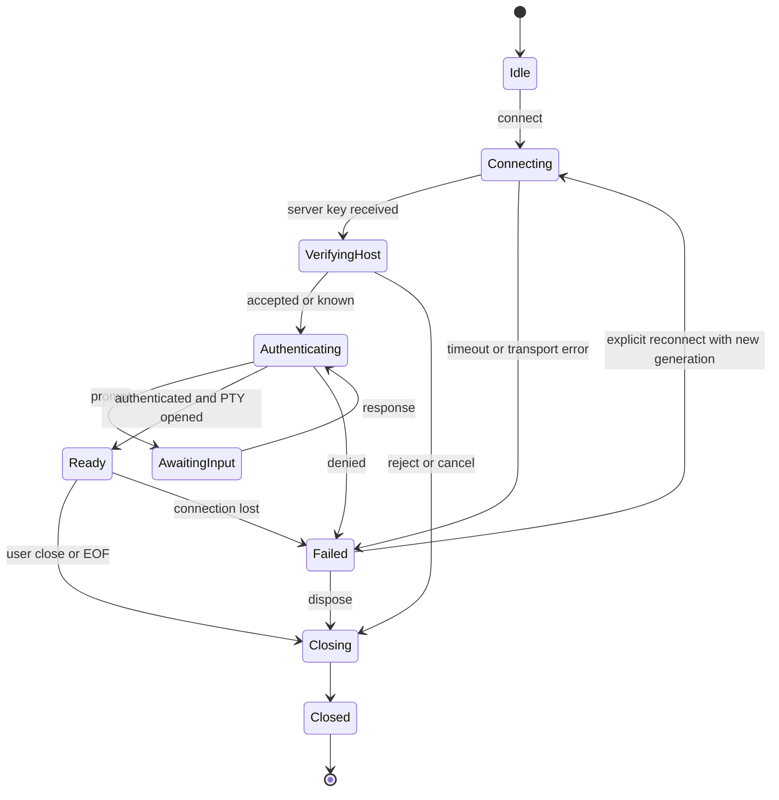

# Architecture ที่เสนอสำหรับ ssterm

**SST-027: automated gate `DONE`** — [MVP gate](../mvp-gate.md): unit 422/422, development E2E 62/62, packaged 59/59, DS05 sweep 0 findings, budgets met, release-blocker audit ไม่พบ critical/high; T033 `DONE`; T034/DS05 ส่วน manual Thai IME/VoiceOver ยังรอผู้ใช้ทำ; SST-028 และ DS06 ยัง `PAUSED`

**ผู้ใช้เลือก UI stack แล้ว: React + Electron + shadcn/ui + Tailwind CSS; อนุมัติ M0 เมื่อ 2026-10-14 และ documentation-only SST-003 เมื่อ 2026-10-15.** SST-001 ADR และ SST-002 isolated spike `DONE` แล้ว ณ 2026-10-15; [SSH compatibility result](../spikes/ssh-compatibility.md) เลือก ssh2 1.17.0 สำหรับ adapter ถัดไป SST-003/T004–T005 อยู่ `DONE` ตาม [spec](domain-storage-spec.md); production SST-001–026 ส่งมอบแล้ว; SST-027 automated gate ส่งมอบแล้ว (manual IME รอผู้ใช้); SST-028 หยุดรอคำสั่ง รายละเอียด services อื่นยังเป็น design proposal ไม่ใช่ production implementation

## Baseline / stack decision

เสนอ macOS arm64 desktop, local-first, account-free, vault เดียวก่อน ใช้ original UI/branding ของ ssterm และ implementation ของโครงการเอง ขอบเขต MVP อยู่ใน SST-001–028

**UI stack ที่ผู้ใช้กำหนด:** Electron เป็น desktop runtime, React + TypeScript เป็น renderer UI, shadcn/ui สำหรับ application components และ Tailwind CSS สำหรับ styling/theme tokens การเลือกนี้เป็นข้อกำหนดของ ssterm ไม่ใช่ผล reverse engineering ของ Termius ส่วน exact pins/tooling/app IDs/layout และ DS01 บันทึกใน [ADR 0001](../adr/0001-mvp-platform-stack.md); สร้าง desktop scaffold แล้วใน SST-004 โดย services ยังไม่มี implementation

| Layer | Stack / responsibility | Decision status |
|---|---|---|
| Desktop runtime | Electron; privileged services อยู่ main/service layer | ผู้ใช้เลือกแล้ว |
| Renderer UI | React + TypeScript | React ผู้ใช้เลือกแล้ว; คง TypeScript ตาม baseline |
| Components | shadcn/ui สำหรับ forms/dialogs/menus/tabs/sidebar และ shared UI primitives | ผู้ใช้เลือกแล้ว |
| Styling / theme | Tailwind CSS และ shared theme tokens | ผู้ใช้เลือกแล้ว |
| Terminal renderer | xterm.js ใน React-owned container; แยก terminal rendering จาก app components | Proposed; validate lifecycle/resize ใน SST-002/012 |
| SSH / SFTP / tunnels | ssh2 1.17.0 selected behind independent adapter | M0 Node/packaged fixture gate ผ่าน; production services ยังรอ SST-008–015 |
| Metadata / secrets | SQLite candidate + OS credential-store adapter | validate driver/protection/packaging ใน SST-001–006 |

[ADR 0001](../adr/0001-mvp-platform-stack.md) บันทึก UI stack และ exact versions/build tooling พร้อม temporary npm peer/engine resolution evidence; ยังไม่พิสูจน์ build/runtime และไม่เปิดเลือก UI framework ใหม่ SST-002 เปรียบเทียบเฉพาะ SSH backend ที่ทำงานร่วมกับ Electron ได้ เช่น Node library, native adapter หรือ managed OpenSSH process; ต้องตรวจ packaging/ABI, authentication, PTY, SFTP และ forwarding

แหล่งทางเทคนิคที่ตรวจวันที่ 2026-10-14: [Electron security](https://www.electronjs.org/docs/latest/tutorial/security) สนับสนุน isolated renderer/validated IPC; [ssh2 upstream](https://github.com/mscdex/ssh2) เป็น candidate client library; [xterm.js security](https://xtermjs.org/docs/guides/security/) ใช้กำหนด terminal trust boundary; [SQLite transactional behavior](https://www.sqlite.org/transactional.html) ใช้ประกอบ persistence choice ไม่ได้สรุปว่าทางเลือกนี้ดีที่สุดก่อน spike

เอกสารสำหรับ UI stack: [React](https://react.dev/learn), [shadcn/ui setup](https://ui.shadcn.com/docs/installation/vite) และ [Tailwind CSS setup](https://tailwindcss.com/docs/installation/using-vite) ใช้อ้างอิง integration ในอนาคต; exact pins/primary registry sources อยู่ใน [dependency baseline](../adr/dependency-baseline.json)

## Design system integration

ใช้ [Design System v1.0 — Signal Blue](design-system.md) เป็น visual specification และ [design-system-implementation.md](design-system-implementation.md) เป็นแผน DS01–DS06; DS01 decisions อยู่ใน ADR 0001; DS02–DS03 อยู่ใน SST-004 ที่อนุมัติแล้ว; DS04 ส่งมอบแล้วใน SST-018; DS05–DS06 ยังหยุดรอคำสั่งโดยคง React/Electron/shadcn/ui/Tailwind stack เดิม

- Application tokens/theme ใช้ semantic CSS variables: navy canvas, blue focus/selection/action และ operational status แยกกัน; Inter สำหรับ UI และ JetBrains Mono สำหรับ code/terminal พร้อม Thai fallback
- เลือก Tailwind 4.3.3 + Base UI/nova/official @shadcn registry/Lucide ตาม ADR; verify generated APIs/config ใน SST-004; global stylesheet/component paths อยู่ใต้ renderer ของ `apps/desktop` และ resolve ตาม `components.json` หลัง bootstrap
- Shared primitives/variants อยู่ `components/ui`; domain recipes แยก connection identity/status, server tree, session tabs/panes, SFTP และ tunnels; presentation แปล typed session state แต่ไม่เปลี่ยน ownership/auth policy
- Dark-first สำหรับ MVP; light palette เป็น later proposal; terminal foreground/background/cursor/selection/ANSI/font settings แยกจาก app theme และไม่ใช้ application CSS override terminal output
- `Host.environment?` เป็น optional display metadata สำหรับ DEV/STAGING/PROD context; แสดง PROD ชัดทุก target-sensitive surface โดยไม่ตีความเป็น access-control rule
- Development-only showcase ใช้ fixture states สำหรับ review tokens/components/recipes; real service/packaged acceptance ยังต้องผ่าน tickets เดิม

Foundation/ADR: SST-001/004; composition: SST-018; visual/accessibility gate: SST-027; fonts/icon package: SST-028 ไม่เพิ่ม agent auth, remote/dynamic tunnels หรือ future patterns จาก spec เป็น MVP capabilities

## Module boundaries

| Module | Public responsibility | ซ่อนรายละเอียดอะไร |
|---|---|---|
| HostCatalog / ConfigResolver | CRUD/search และ effective config พร้อม provenance | persistence, hierarchy traversal, per-field inheritance |
| SecretStore | publish/read/retire ผ่าน immutable opaque SecretRef และ stable operation lookup | Keychain namespace/provider/errors, memory caching |
| ConnectionService | connect/auth/cancel/close, state/error/prompt events | SSH engine, socket lifecycle, callbacks และ capability ownership |
| TerminalSession | ordered input/output, resize, bounded flow control, dispose | transport channel, encoding framing และ buffers |
| KnownHostPolicy | query/first-use/change/revoke decision | fingerprint representation และ persisted trust lookup |
| FileTransferService | browse/read/upload/download/cancel/progress | SFTP handle ownership, partial file policy, concurrency |
| TunnelService | rule validation/start/stop/status | listener/socket cleanup, bind conflicts และ transport handles |
| SnippetService | CRUD/Paste/Run ไป active target | target lookup, line ending และ dispatch semantics |
| MetadataRepository | transactional writes/query/migrate | storage driver, indexes/versioning และ recovery |

ไม่มี generic IPC function ที่รับ arbitrary module/method/path renderer ได้เฉพาะ typed commands และ sanitized events; secrets ไม่ใส่ใน serialized renderer state, terminal history หรือ logs Secret input ที่ผู้ใช้กรอกใน UI เป็น transient ส่งผ่าน restricted secret command แล้วล้าง state ไม่อ้างว่าทำให้ไม่มี plaintext ใน memory ทุกช่วง

## Domain model ที่เสนอ

Normative logical fields/defaults/constraints, ER, inheritance/delete impact และ storage lifecycle อยู่ใน [SST-003 domain/storage specification](domain-storage-spec.md); ตารางนี้เป็นภาพรวม; runtime schema v1 และ actual validation อยู่ใน [SQLite implementation](../local-storage.md)

| Entity | Proposed fields / invariants |
|---|---|
| LocalVault | stable UUID, label, contentKeyRef; database-level schema version; MVP มีหนึ่ง vault ไม่ต้องมี account |
| Group | id, parentId?, label, field overrides; parent เดียว, ไม่มี cycle, vault เดียวกัน |
| Host | id, groupId?, label, address, direct tag assignments, environment?, port/auth overrides; port 1–65535; environment เป็น display metadata |
| Identity | id, label, username, exclusive password/key/keyboard-interactive method + typed SecretRefs/keyRef; ใช้ร่วมได้หลาย hosts เป็น atomic bundle |
| KeyMetadata | id, label, public key/fingerprint/type, required privateKeyRef และ optional passphraseRef; private key/passphrase ไม่อยู่ใน metadata |
| KnownHost | normalized endpoint(host+port), algorithm, key/fingerprint, firstAcceptedAt, lastVerifiedAt |
| Snippet | id, label, mandatory authenticated bodyEnvelope, keyRef/protection version, direct tags; ไม่มี plaintext body/preview/search index |
| TunnelRule | id, hostId, type=local, bindAddress=loopback, bindPort, destinationHost/Port |
| Session | ephemeral id, host/config snapshot, state, channel capabilities; ไม่ persist auth prompts/passwords |
| TransferJob | ephemeral id, session/file endpoints, bytes/total?, state, error; persistence ของ queue ไม่อยู่ใน MVP |
| AppSettings | vault-scoped theme/font/scrollback allowlist พร้อม bounds/defaults; schema version อยู่ database |

Persist metadata แบบ versioned/transactional; baseline ให้ OS Keychain เก็บ credentials และ encryption key ของ app-local encrypted sensitive content (เช่น snippet bodies) ผ่าน mature crypto/storage provider ไม่สร้าง cryptographic construction เอง [SST-003](domain-storage-spec.md) ระบุ field protection matrix และ lock/recovery/journal contracts; SST-005/006 ต้อง verify storage/OS Adapter และเลือก mature authenticated-protection provider ก่อน coding ที่พึ่งพา capability นั้น ข้อเสนอไม่ได้อ้างว่า SQLite เองเข้ารหัส database โดย default

Group inheritance: resolve ทีละ field จาก host → nearest ancestor override → root → defaults port override เป็น `inherit|value` (default 22); auth override เป็น `inherit|value(identity)|clear` (default none) โดย clear หยุด traversal เพื่อแยก unset/empty ไม่ merge username/password ข้าม identity คนละชุด; identity/auth selection resolve เป็นหนึ่งหน่วย ย้าย group ตรวจ cycle และแสดง provenance เปลี่ยน parent กระทบ connections ครั้งใหม่; live session ใช้ config snapshot เดิม

Delete group ใช้ explicit move/delete-subtree choice พร้อม inherited impact preview; delete referenced identity ต้องรายงาน direct/inherited affected hosts และให้ detach-to-clear/reassign ก่อนลบ ไม่ cascade secret โดยเงียบ KnownHost เป็น endpoint-scoped record ของ vault ไม่ผูก label ของ Host จึงป้องกัน duplicate catalog entries แสดง trust ต่างกัน

## Session contract และ lifecycle

Diagram เป็น high-level contract; cancel ใช้ได้ทุก nonterminal state รวม AwaitingInput กำหนดใน SST-008 State `Ready` หมายถึง interactive channel เปิดสำเร็จ ไม่ใช่ TCP connected อย่างเดียว

Command/event design ที่ต้องปิดรายละเอียดใน SST-004/008:

- Commands: connect(hostId, requestId), answerPrompt(promptId, response), cancel(connectionId), openTerminal(connectionId), write(sessionId, bytes), resize(sessionId, columns, rows), close(sessionId)
- Events: StateChanged, PromptRequested, Output(chunk, sequence), RemoteExit, Error(code, sanitized context), Closed; ใช้ connection generation ปฏิเสธ late events หลัง cancel/reconnect
- Error taxonomy: invalid-config, host-key-untrusted/changed, auth-denied, prompt-cancelled, timeout, dns/network, channel-open-failed, subsystem-unavailable, resource-limit; storage preserves typed missing/locked/denied/unavailable/unknown/error outcomes and retry rules from the [SecretStore contract](domain-storage-spec.md#lock-missing-keys-and-backup), including ambiguous mutation reconciliation rather than blind retry
- Backpressure: bounded queue, pause/resume หรือ byte acknowledgements, preserve stream order และไม่มี silent drop หากเกิน limit ต้องมี explicit outcome
- `close`/`dispose` idempotent; prompt cancellation/timeout คืนทรัพยากร; app quit ปิด sessions/jobs/listeners; lifecycle test ตรวจ leaked workers/handles
- MVP reconnect เป็น manual สร้าง transport/channel ใหม่ ไม่ replay commands/input ไม่รับประกัน remote process continuity

## Feature semantics ที่ต้องกำหนด

**Known hosts:** first use แสดง endpoint/algorithm/fingerprint ให้ accept once หรือ remember; changed key block connection และเข้าสู่ explicit trust replacement flow การจำ trust ต้องเกิดหลังผู้ใช้ตัดสินใจ ไม่ใช่ auto-accept default นี่เป็น ssterm requirement; actual Termius prompt behavior ยัง unknown

**Terminal:** output เป็น terminal byte stream ไม่ render HTML; URLs เปิดผ่าน scheme allowlist หลัง user action; clipboard/paste ต้องรู้ active session; bracketed paste เมื่อ server/app รองรับ ไม่ส่ง auto-execute เพื่อแก้ multiline paste UTF-8/combining characters/IME ต้องทดสอบกับ real fixture

**Snippets:** Paste ใส่ข้อความเข้า local pending-input composer ให้ผู้ใช้ตรวจ ก่อนส่งไป remote; Run dispatch body พร้อม execution line ending ไป active session ตาม explicit action การเปลี่ยน active pane หลัง click ไม่เปลี่ยน captured target การรายงาน sent ไม่เท่ากับ command success ทั้งสองเป็น proposed semantics และ SST-024 ต้องตรวจ UX ให้ชัดก่อน code

**SFTP:** MVP local↔remote, authenticated independent capability; unknown/changed server keys ผ่าน policy เดียวกับ terminal overwrite ต้องมี explicit decision; cancel มี partial-file policy; progress ไม่ใช้ 100% จน destination write/close สำเร็จ symlinks แสดงเป็น symlink และ follow เฉพาะ navigation ที่ผู้ใช้เลือก; ไม่ recursive-follow ใน initial transfer implementation

**Tunnel:** loopback default; start ถือว่าสำเร็จหลัง local bind + SSH ready; duplicate port แจ้ง error; stop/quit ตัด listener และ active sockets ตาม policy ไม่เริ่ม tunnel อัตโนมัติจากการเปิดแอป

## ADR-selected future layout

`apps/desktop` สำหรับ app composition/UI, `packages/domain` สำหรับ catalog/resolver, `packages/contracts` สำหรับ API/events, `packages/services` สำหรับ lifecycle, `packages/adapters` สำหรับ SSH/storage/secrets และ `tests/fixtures` สำหรับ isolated SSH/SFTP lab ADR 0001 กำหนด `apps/desktop/src/{main,preload,renderer/src}` พร้อม renderer alias `@/*`; SST-002 ใช้ isolated `spikes/ssh-compat` และ `tests/fixtures/ssh` หลัง first commit ยังไม่สร้าง directories/code เหล่านี้ใน SST-001

## Later boundaries

Cloud/team ทำเป็น service protocol ใหม่แยก local vault; encrypted envelopes, key lifecycle, migration, conflict/tombstones, device identity และ revoke เป็น gate ก่อน implementation ของ sync Logs/AI/broadcast ต้องมี target/retention semantics ต่างหาก Local PTY, Mosh/FIDO, proxy/chaining, remote/dynamic tunnels และ cross-platform เป็น optional adapters/capabilities ไม่ให้กลายเป็น dependency ของ SSH MVP

SST-007 implements the HostCatalog/config resolver contracts in [domain/services catalog Modules](../catalog.md), including immutable config capture, explicit search scope and revision-fenced destructive previews. No catalog renderer command is added.

SST-008 implements the engine-independent [SessionRegistry and desktop lifecycle composition](../sessions.md): private frozen config capture, owner/attempt generation fencing, typed metadata snapshots/prompts/errors and bounded resource teardown. Host-trust prompts stay VerifyingHost; credential prompts enter AwaitingInput. No renderer IPC or production SSH/trust/auth Adapter is added; those remain SST-009/010+.

SST-010 integrates the [production saved-host SSH adapter](../ssh-auth.md) through the shared policy and Keychain provider. Main captures current inherited metadata, reads only selected published SecretRefs after trust, checks private/public key identity and owns a paused interactive shell. Missing-credential prompts and terminal byte delivery remain SST-011/012; no connect/credential renderer capability is introduced.

SST-011 integrates the [credential prompt boundary](../auth-prompts.md): transient password/passphrase and selected keyboard-interactive, atomic prompt-specific cancellation, owner/sequence-fenced events and uncontrolled inputs. No server instructions, credential persistence/cache or renderer connect/terminal capability is added.

SST-012 integrates the [terminal stream](../terminal.md): the SSH adapter owns ordered output, a 256 KiB credit window, the input backlog bound, PTY resize and remote end reporting; `SessionRegistry.terminal(owner, id, generation)` is the single capability fence; output frames go only to the owning window; xterm.js renders bytes through the declared trust boundary. Remote exit status/signal/EOF is distinct from local close, and socket loss after Ready is `Failed`/`network`. No renderer connect command is added (SST-016).

SST-013 adds the [terminal input policy](../terminal-input.md): Unicode 11 widths, IUTF8, sanitized and confirmed paste, Cmd+click links through a validated main handler with native confirmation, per-pane search and an explicit menu without packaged reload/DevTools.

SST-014 bounds the [terminal flow](../terminal-flow.md): validated output credit and input backlog options, a single atomic write per paste, hostile-peer buffering caps with `resource-limit`, and a measured budget recorded with hardware and workload.

SST-015 completes the [terminal lifecycle](../terminal-lifecycle.md): generation-fenced close/reconnect/dismiss from the renderer, projected failure reasons, SSH keepalive, lock recovery through an explicit Reconnect, one xterm per logical session across reconnects, and leak-free close, quit and crash cleanup.

SST-016 exposes the [catalog UI](../catalog-ui.md): a pushed owner-bound catalog state without secret references, revision-fenced prepare/apply with field errors, renderer search with domain parity, and `connectHost` on the production registry.

SST-017 adds [identities and SSH keys](../identities.md): main-only key import with derived metadata, Keychain writes through SecretService with lock gating, a commit observer that republishes catalog state, and a fail-closed test Keychain namespace.

SST-018 adds the [workspace](../workspace.md): flat stable pane mounting with tab split trees, key-code shortcuts, in-app and native close prompts, a validated terminal settings IPC that no longer advances the catalog revision, and the DS04 terminal-first shell.

SST-019 adds the [SFTP capability](../sftp.md) as a registry session kind with its own connection and a main-only `SftpSession` with bounded handles and requests, typed failures and hang-free disposal.

SST-020 adds the [Files browser](../sftp-browser.md): a main-only local metadata provider, fenced file IPC over local and remote sources, a kind-checked lifecycle helper shared with terminals, and a keyboard-first dual-pane UI with safe name display.

SST-021 adds the [transfer job service](../transfers.md): two process-wide workers, 100 retained jobs, regular-file-only local↔remote copying, owner/generation-fenced metadata IPC, confirmed-byte progress and close-gated completion. Native local I/O keeps quarantined permits and close/quit counts until actual cleanup; stalled remote I/O invalidates only its captured SFTP generation. SST-022 adds [conflict decisions and staged publication](../transfer-conflicts.md): per-file Overwrite/Skip/Rename, same-directory `.part` staging, capability-gated replacement, retained stages (no automatic cleanup) and fresh-consent retry.
