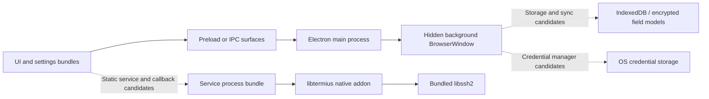

# ระบบ Termius จาก installed artifact

**สถานะ:** static investigation ที่มี coverage บางส่วน; พร้อมใช้เตรียม backlog แต่ยังไม่ยืนยัน runtime parity และยังไม่เริ่ม implement

## Target และวิธีตรวจ

เลือก target จากชื่อแอปที่ผู้ใช้ระบุ: `/Applications/Termius.app` เป็น match เดียวที่พบใน standard system/user Applications paths ที่ตรวจ Bundle ID `com.termius-dmg.mac`, Info.plist และ package manifest ระบุ version `9.43.1`; ASAR ขนาด 161,627,133 bytes, SHA256 `404ec37b5b00867eea47c6e99f2fffb9ea013e00fbb7df16c5cb85ee64ff5bff` [artifact identity](evidence/artifact-identity.json)

ใช้ [skill ที่ร้องขอ](../../.agents/skills/reverse-engineer-anything/SKILL.md), REA CLI `6.5.0`, Python สำหรับ ASAR inventory/byte anchors และ `file`/`otool`/`nm` สำหรับ native boundary ไม่มี REA MCP tools ใน session; doctor พบ registration drift จึงใช้ CLI fallback ตาม skill โดยไม่แก้ client configuration และไม่ติดตั้ง native decompiler

REA focused analysis สำเร็จบน 10 selected paths อ่าน text 449,011 bytes, parsed JS 6 files, parse failures 0, findings 320; ยังเหลือ relevant inventoried files 5,768 รายการนอก source selection และ semantic node ceilings 1,000/file, 8,000/global ทำให้ coverage partial [REA metadata](evidence/rea-analysis-metadata.json)

Parent Evidence: `ev_6a67d56d861c986c02de1c40c8bcc97a7caf5bbb752ed0d839dcb874741e8c87` (**R01**). Summary view: `ev_272c301c09f47e1f3447ad589c4d28dd908d9d33f08b51ac23924035b8b08147` (**R02**). ดู [evidence guide](evidence/README.md) สำหรับ complete compressed parent และการ reproduce

## การจัดระดับข้อสรุป

| ประเภท | หมายถึง |
|---|---|
| Observed static | พบ bytes, syntax, manifest, source ranges หรือ linkage โดยตรง; ไม่ยืนยัน execution |
| Published | ผู้ผลิตอธิบายใน official docs ณ วันที่ตรวจ; อาจใหม่กว่า installed version |
| Inferred | ความสัมพันธ์/บทบาทที่อนุมานจากหลักฐาน มีขอบเขตและข้อจำกัดกำกับ |
| Proposed | ข้อกำหนด/architecture ที่เสนอให้ ssterm; ไม่ใช่ข้อเท็จจริงของ Termius |
| Unknown | ยังไม่มี evidence type ที่เพียงพอ; ต้อง spike, runtime หรือ protocol research เพิ่ม |

S01–S07 เป็น ordinary-shell static observations พร้อม hash และ byte ranges ใน [static-observations.json](evidence/static-observations.json); N01–N08 เป็น ordinary-shell native observations ใน [native-shell.json](evidence/native-shell.json) ไม่ใช่ REA Evidence IDs ส่วน W01–W12 ดู [official source register](official-features.md#source-register)

## Layers ที่เห็นใน artifact

เป็นแผนภาพ **inferred static structure**: arrows ไม่ได้ยืนยัน runtime topology ทั้งหมด โดยเฉพาะผู้สร้าง/owner/lifecycle ของ service process ยังไม่ได้ trace ครบ

| Layer | Observed static | สิ่งที่ใช้วางแผน / ข้อจำกัด | Evidence |
|---|---|---|---|
| Main | manifest entrypoint `main-process/main-process.js`; มี BrowserWindow constructors, background `loadFile`, `init-redux` และ `redux-action` | inferred ว่าจัด window lifecycle และ state retranslation; constructors ไม่ยืนยันว่าทุก window ถูกสร้างจริง | artifact, S01 |
| UI / settings | HTML/bundles ที่แยก UI/settings, native transport adapters และ selectors ใน UI bundle | navigation/state อยู่เหนือ service boundary; exact React/runtime versions ไม่ได้ยืนยัน | S05–S07 |
| Preload | มี custom `exposeInMainWorld` ที่เขียน `window.api` และ module-loader list รวม filesystem/crypto/native modules | ชื่อนี้ไม่ได้พิสูจน์การใช้ Electron contextBridge; ต้องกำหนด API ใหม่ให้แคบ | S02 |
| Background | entity repositories, IndexedDB/Dexie store declarations, crypto field lists, settings/sync services | static storage/encryption intent; ยังไม่อ่าน database snapshot หรือยืนยัน disk encryption ทุก field | S04 |
| Service | dispatch ของ shell/exec/forwarding, connection/shell/callback maps, native `SshClient`, auth/host verification callbacks | มี contract shape ให้แตกเป็นโมดูล; callbacks/dependencies dynamic จึงยังไม่รู้ครบ | S03, R01 |
| Native | architecture loader ของ addon, libssh2 linkage, keytar API, PTY queue/lifecycle, Mosh/FIDO symbols | wrappers trace ได้บางส่วน; native algorithms และ runtime exports ยังไม่ยืนยันครบ | N01–N07 |

Main source มี internal window option literals `nodeIntegration: true`, `contextIsolation: false` และ website window literals ที่ตรงข้าม [S01](evidence/static-observations.json) ข้อนี้เป็น observation ของ constructor syntax ไม่ใช่ security audit หรือผล runtime และไม่ใช่ข้อกำหนดที่ ssterm ต้องทำตาม

## Domain และ persistence ที่พบ

Background source byte anchors แสดง model/repository definitions ดังนี้ [S04](evidence/static-observations.json):

| Model | Fields/relationships ที่เห็นบางส่วน | ข้อสรุปที่ใช้ได้ |
|---|---|---|
| Host | `address`, `label`, cloud instance fields; SSH/config/group relations | แยก target metadata กับ connection config ได้ |
| Group | `label`, parent group, sharing/credentials modes | hierarchy มีหน้าที่มากกว่าการจัด folder; published inheritance ยืนยันเพิ่มใน W02 |
| Identity | `label`, `username`, `password`, key relation, visibility | reusable credential bundle แยกจาก host |
| PrivateKey | label/passphrase/private/public key; `keys` store | source จัด fields เหล่านี้เป็น crypto fields; crypto implementation ยัง unknown |
| KnownHost | hostnames/key; `known_hosts` store | มี persisted trust data; prompt/changed-key policy ยัง unknown |
| Snippet / package | label/script/package relation | แยก reusable command จาก connection session |
| PortForwardingRule | hostname/label/bound address/local+remote port/type/host | config เป็น persisted rule; active tunnel เป็น runtime resource |
| Proxy / tags / history / templates | พบ repository definitions และ migration code บางส่วน | เป็น later scope ที่แยกได้ ไม่ได้ถอด schema ทั้งหมด |

พบ indexed store schema literal `++local_id,&local_id,&id,status` ใน repositories และ model lists ที่ระบุ crypto/plain fields สิ่งนี้สนับสนุน inference ว่ามี local identity + remote identity + sync status แต่ยังไม่ทราบ full status transitions, unique constraints และ backend conflict algorithm

อย่านำ field list นี้ไปใช้เป็น schema migration ที่เข้ากับ Termius โดยตรง: ยังไม่ยืนยัน ciphertext envelope, relations ทั้งหมด, version history และ database layout จริง

## เส้นทาง connection / terminal ที่ trace ได้

**Observed static, S03/S05:** service dispatcher รับ `shell`, `exec`, `shell.sendData`, `shell.sendBinary`, `shell.sendSize`, `shell.close`, `portForwarding`, `portForwarding.close`, `callback.call` และ `closeAllServices` มี maps แยก connection/shell/tunnel/callback และ callbacks สำหรับ hostVerifier, passphrase, keyboard-interactive, signing และ error/disconnect

**Inferred flow:** UI resolve host/config → service request พร้อม connection ID → native SSH client → callback ขอข้อมูล/host trust/auth จาก UI → เปิด shell → data/resize events → close และ cleanup หลักฐานยังไม่ยืนยันทุกขั้นตอนเกิดในลำดับนี้เสมอหรือ concurrency/cancellation ถูกต้องใน runtime

**Proposed for ssterm:** [connection state machine](proposed-architecture.md#session-contract-และ-lifecycle) ต้องเป็น contract ที่ทดสอบได้ ก่อนสร้าง UI ที่ผูกกับ native engine เพื่อครอบคลุม race ระหว่าง connect/auth/cancel/close และ secret handling

## SFTP / forwarding / snippets / workspaces

- **SFTP:** UI/service มี native `sftp` call และ ready/disconnect/error callbacks พร้อม subsystem-unavailable message [S03/S05]. Official docs อธิบาย local/remote panes, transfer และ external-edit flow [W05](https://docs.termius.com/organize-and-connect-to-hosts/managing-files-with-sftp). Resume/cancel/overwrite semantics ของ installed build ยัง unknown
- **Forwarding:** source switch เลือก local/remote/dynamic native methods [S05]; published UI มี rule configuration/start/stop [W08](https://docs.termius.com/organize-and-connect-to-hosts/port-forwarding-and-tunneling). Bind/reuse/auto-restart defaults ยัง unknown
- **Snippets:** source พบ persisted script model [S04]; Published แยก Paste/Run, startup และ screen multi-run ที่เปิด connections ใหม่ [W07](https://docs.termius.com/terminal/snippets). แผน MVP เลือก active-session Paste/Run ก่อน
- **Workspace:** Published มี Focus/Split และ templates/broadcast [W06](https://docs.termius.com/terminal/workspaces). การคืน remote processes หลัง app restart ยังไม่ยืนยัน; ssterm จะไม่ตั้งสมมติฐานว่า layout restore เท่ากับ session persistence

## Cloud / security boundary

พบ sync/key-manager/crypto field candidates ใน background และ crypto/SRP/SEP/WebAuthn symbol candidates ใน native bytes [S04, N07]. ผู้ผลิตเผยแพร่ E2EE/Encryption Password/team vault claims [W09](https://docs.termius.com/security/encryption-overview), [W11](https://docs.termius.com/team-collaboration/team-vaults).

ยังไม่ได้ยืนยัน cloud API schema, server-side services, auth protocol parameters, key derivation, encryption envelope, conflict algorithm, revocation/rekey หรือ enforcement จึงเสนอ backend ของ ssterm เป็นการออกแบบใหม่ใน later scope ไม่ใช่ Termius-compatible backend ไม่จำเป็นต้องมี cloud เพื่อผ่าน MVP

## Finding ledger / original question checklist

| คำถาม | สถานะ | ข้อสรุปและหลักฐาน | Remaining work / ticket |
|---|---|---|---|
| Target/version/package identity? | Answered within installed target | manifest/plist + ASAR digest; R01/R02/artifact | หาก target เปลี่ยนต้อง rebind digest |
| Feature/workflow inventory? | Partially answered | official inventory + static corroboration; W01–W12/S03–S05 | installed runtime validation; SST-001,027 |
| Processes/modules/IPC? | Partially answered | S01–S03 + selected REA syntax; service ownership ยัง unknown | ใหม่ใช้ contract ที่กำหนด; SST-004,008 |
| Host/group/identity/storage model? | Partially answered | S04 + published inheritance; actual disk schema ไม่ได้ตรวจ | กำหนด schema และ semantics ใหม่; SST-003,005–007 |
| SSH/auth/terminal lifecycle? | Partially answered | S03/N01/N03 + published auth; no runtime | controlled backend spike; SST-002,009–015 |
| SFTP/tunnel/snippet flows? | Partially answered | S03–S05/W05–W08 | own implementation tests; SST-019–026 |
| Native crypto/backend internals? | Unresolved | symbol/caller candidates เท่านั้น | SST-036,038; ไม่เป็น MVP prerequisite |
| UI pixel details/shortcuts/accessibility? | Unresolved | ไม่ได้ capture UI | original UI spec + lab walkthrough; SST-016–018,027 |
| Implementable tasks/tickets/plan? | Answered as proposal | linked backlog + gates + validation | ผู้ใช้ confirm ขอบเขตก่อนเริ่ม |

## Coverage / negative search limits

ASAR ordinary inventory มี 6,568 file entries และ `.map` entries 1,727 รายการ; ไม่ได้ recover ทุก source map REA relevant-file count 5,778 มีนิยามต่างจาก total ASAR entries อย่าตีความสองจำนวนเป็น coverage ratio เดียวกัน

REA summary ที่นับ BrowserWindow/IPC ได้ 0 มาจาก selected source boundary และ alias/dynamic extraction limits ไม่ใช่หลักฐานว่าแอปไม่มี IPC/window การตรวจ main/preload/background เพิ่มใน S01–S04 เป็น bounded syntax inspection ไม่มี semantic equivalence claim

ASAR integrity contradictions 17 รายการถูกเก็บครบใน metadata; analysis อ่าน observed installed bytes แบบ untrusted ไม่ได้ตรวจ code-signature chain เพื่อระบุสาเหตุ ไม่มี runtime, private profile access, historical/live captures, native pseudocode หรือ backend verification ในรอบนี้
